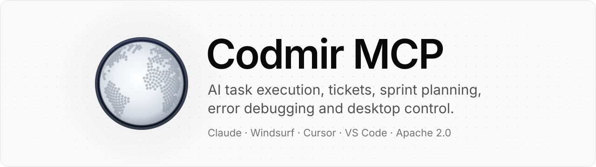
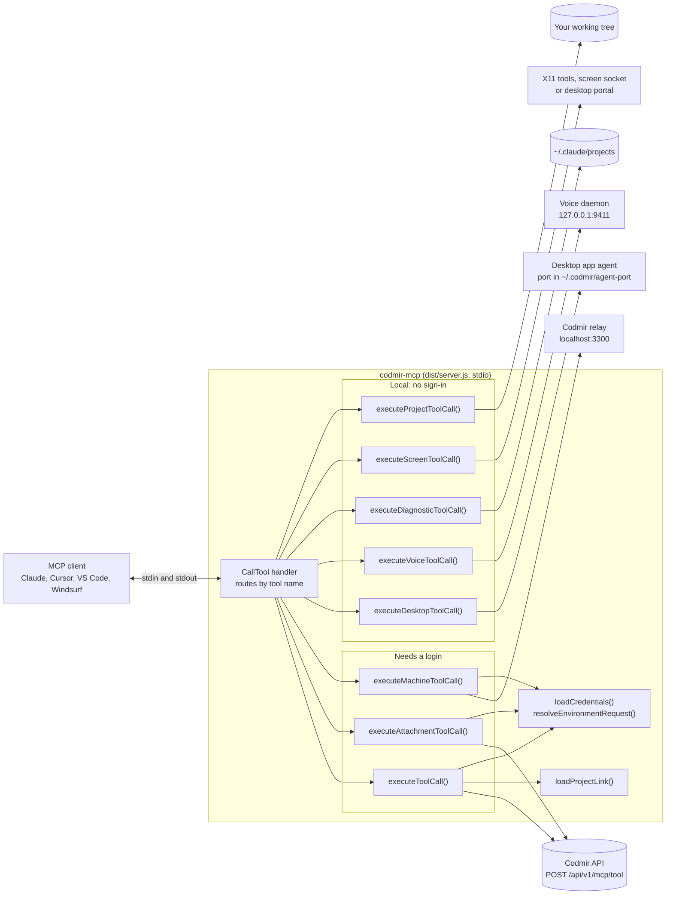
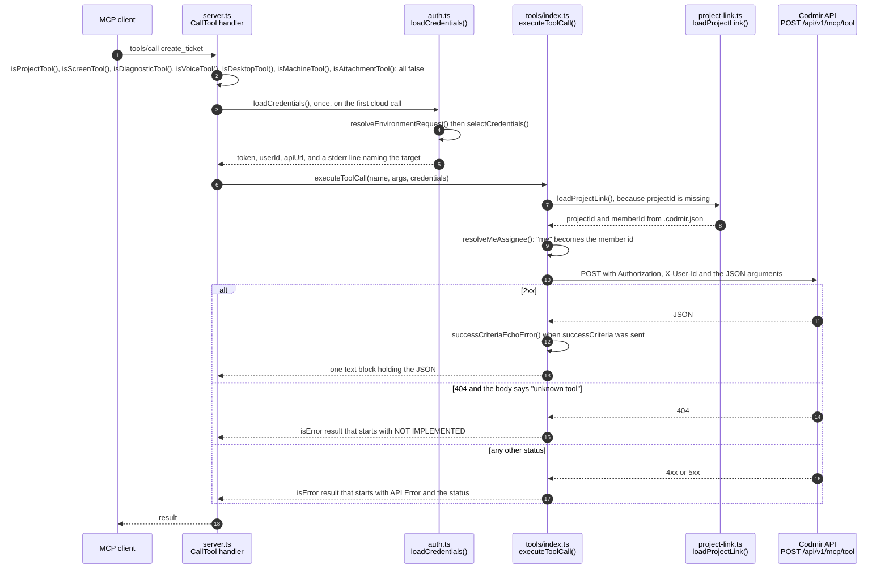

<p align="center">
  <picture>
    <source media="(prefers-color-scheme: dark)" srcset="https://raw.githubusercontent.com/codmir-labs/mcp/main/docs/assets/hero-dark.svg">
    <source media="(prefers-color-scheme: light)" srcset="https://raw.githubusercontent.com/codmir-labs/mcp/main/docs/assets/hero-light.svg">
    
  </picture>
</p>

<p align="center">
  <a href="https://www.npmjs.com/package/@codmir/mcp"></a>
  <a href="https://github.com/codmir-labs/mcp/blob/main/LICENSE"></a>
  <a href="#requirements"></a>
  <a href="#how-it-works"></a>
  <a href="#programmatic-use"></a>
</p>

<p align="center">
  <a href="#clients"></a>
  <a href="#clients"></a>
  <a href="#clients"></a>
  <a href="#clients"></a>
  <a href="#tool-reference"></a>
  <a href="#screen-vision"></a>
  <a href="#voice"></a>
  <a href="#the-codmir-diagnostic-command"></a>
  <a href="#programmatic-use"></a>
  <a href="#requirements"></a>
</p>

<p align="center">
  <a href="#quick-start"><b>Quick start</b></a> ·
  <a href="#clients"><b>Clients</b></a> ·
  <a href="#how-it-works"><b>How it works</b></a> ·
  <a href="#tool-reference"><b>Tools</b></a> ·
  <a href="#configuration"><b>Configuration</b></a> ·
  <a href="#safety"><b>Safety</b></a> ·
  <a href="#troubleshooting"><b>Troubleshooting</b></a> ·
  <a href="#faq"><b>FAQ</b></a> ·
  <a href="https://codmir.com"><b>codmir.com</b></a>
</p>

AI-powered project management for your coding assistant. The official [Model Context Protocol](https://modelcontextprotocol.io)
server for [Codmir](https://codmir.com): create tickets, manage sprints, run AI tasks, debug production errors, read and
write documentation, and report bugs against any vendor, all through natural language. When the Codmir desktop app is
running it can also see and control your screen. One stdio server with 83 tools, and a `codmir-diagnostic` command that
turns an AI coding session into a bug report.

Works with **Claude Desktop**, **Claude Code**, **Cursor**, **VS Code** and **Windsurf**.

```bash
npx -y -p @codmir/mcp codmir-mcp
```

Your MCP client starts this for you; [Quick start](#quick-start) shows how. The `-p` form is deliberate: the package has
two commands, so a bare `npx @codmir/mcp` cannot pick one (see [Troubleshooting](#troubleshooting)).

> [!NOTE]
> This page documents the source on `main`, which registers 83 tools and two commands, `codmir-mcp` and
> `codmir-diagnostic`. The latest release on npm, `@codmir/mcp` 0.2.5, registers 33 of those tools and has only
> `codmir-mcp`. The [tool reference](#tool-reference) has an **In 0.2.5** column, and a parameter or enum value that
> 0.2.5 lacks says so. Compare `npm view @codmir/mcp version` with 0.2.5 to see whether a newer release has shipped.

<details>
<summary><b>Contents</b></summary>

- [Why Codmir MCP](#why-codmir-mcp)
- [Quick start](#quick-start)
- [Clients](#clients)
- [Tell your assistant when to use it](#tell-your-assistant-when-to-use-it)
- [How it works](#how-it-works): [the server at a glance](#the-server-at-a-glance), [where each tool runs](#where-each-tool-runs), [one tool call](#one-tool-call), [a real tool call, end to end](#a-real-tool-call-end-to-end)
- [Authentication](#authentication)
- [Target environment](#target-environment)
- [Default project](#default-project)
- [Tool reference](#tool-reference): [workspace](#workspace-and-projects), [tickets](#tickets-and-sprints), [AI tasks](#ai-task-execution), [goals](#goals-and-the-work-graph), [errors](#error-debugging), [docs](#documentation-and-memory), [SDK](#sdk-helpers), [phone](#phone-calls), [bugs](#bug-reports), [requests](#feature-requests), [feedback](#model-feedback), [session diagnostics](#ai-session-diagnostics), [project awareness](#project-awareness), [desktop](#desktop-control), [screen vision](#screen-vision), [voice](#voice), [machines](#bridged-machines), [success criteria](#success-criteria), [what the local tools need](#local-tools-what-they-need)
- [Reporting bugs and requesting features](#reporting-bugs-and-requesting-features)
- [The `codmir-diagnostic` command](#the-codmir-diagnostic-command)
- [Safety](#safety)
- [Configuration](#configuration): [environment variables](#environment-variables), [files](#files)
- [Programmatic use](#programmatic-use)
- [Examples](#examples)
- [Requirements](#requirements)
- [Troubleshooting](#troubleshooting)
- [FAQ](#faq)
- [Repository layout](#repository-layout)
- [Development](#development)
- [License](#license)
- [Links](#links)

</details>

## Why Codmir MCP

<table>
<tr>
<td width="33%" valign="top">
<br>
<b>Tickets and sprints</b><br>
Create, search, update and comment on tickets, read a sprint, move work to done and log time and files. <code>assigneeId: "me"</code> resolves from your project link.
</td>
<td width="33%" valign="top">
<br>
<b>AI tasks and goals</b><br>
Queue a code task for a Codmir agent, or give a goal to the engine that plans, does and checks it in cycles, in parallel waves.
</td>
<td width="33%" valign="top">
<br>
<b>Error debugging</b><br>
Look up a production error by any reference and get its stack, suggested files to open and similar resolved issues.
</td>
</tr>
<tr>
<td width="33%" valign="top">
<br>
<b>Documentation</b><br>
Search, read, create and update a project's documentation pages, import a markdown bundle, or save a conversation as a page.
</td>
<td width="33%" valign="top">
<br>
<b>Bug reports and requests</b><br>
File, search, upvote and comment on bug reports and feature requests against any vendor. Filing works without an account.
</td>
<td width="33%" valign="top">
<br>
<b>Desktop control</b><br>
Screenshot, click, type, scroll and run a shell command on the machine where the Codmir desktop app runs.
</td>
</tr>
<tr>
<td width="33%" valign="top">
<br>
<b>Screen vision</b><br>
Capture one window, one display or a long page top to bottom on Linux, so the assistant can check what it built.
</td>
<td width="33%" valign="top">
<br>
<b>Voice</b><br>
Say one line out loud, ask a question and hear the answer, through a local voice daemon.
</td>
<td width="33%" valign="top">
<br>
<b>Project awareness</b><br>
Ask the working tree whether a type already exists, list symbols defined in many files, and check a claim before you make it.
</td>
</tr>
<tr>
<td width="33%" valign="top">
<br>
<b>Session diagnostics</b><br>
Turn a Claude Code session transcript into a redacted bug report, from a tool or from the <code>codmir-diagnostic</code> command.
</td>
<td width="33%" valign="top">
<br>
<b>Bridged machines</b><br>
List and call the MCP servers that other machines have registered with a Codmir relay.
</td>
<td width="33%" valign="top">
<br>
<b>Safe by default</b><br>
Production unless you say otherwise, a mistyped environment is an error, and a login is never sent to a different host.
</td>
</tr>
</table>

## Quick start

1. **Check that it starts.** The server speaks MCP over stdin and stdout and logs to stderr, so on its own it prints a
   banner and waits for a client. Stop it with Ctrl-C.

   ```bash
   npx -y -p @codmir/mcp codmir-mcp
   ```

   ```text
   ✺ Detected provider: unknown
   ✅ Codmir MCP Server started
   📦 Available tools (83): get_sprint_tasks, execute_task, create_ticket, ...
   ```

   The count is the number of tools in the version you ran: 83 on `main`, 33 in 0.2.5.

2. **Add it to your client.** Every client takes the same entry; only the file differs. See [Clients](#clients).

   ```json
   {
     "mcpServers": {
       "codmir": {
         "command": "npx",
         "args": ["-y", "-p", "@codmir/mcp", "codmir-mcp"]
       }
     }
   }
   ```

3. **Sign in.** The cloud tools need a Codmir login. Install the Codmir CLI and sign in, or pass a token and user id as
   environment variables (see [Authentication](#authentication)).

   ```bash
   npm install -g codmir
   codmir login
   ```

   Codmir's installer does the same install (`npm install -g codmir@latest`) if you prefer a one-liner:

   ```bash
   # macOS and Linux
   curl -fsSL https://www.codmir.com/install.sh | bash

   # Windows PowerShell
   irm https://www.codmir.com/install.ps1 | iex
   ```

4. **Link the repository** to its Codmir project, so tools that take a `projectId` fill it in (see
   [Default project](#default-project)).

   ```bash
   codmir link
   ```

5. **Ask for something.** Restart the client, then try "What's on my to-do list?" or "Call get_workspace_status".

> [!TIP]
> You do not need an account for everything. `report_bug`, `report_feedback` and `feature_request` work anonymously, and
> the local tools (project awareness, screen vision, voice, desktop control and session diagnostics) never call the
> Codmir API. See [Where each tool runs](#where-each-tool-runs).

## Clients

| Client             | Where the server is configured                  | How                                          |
| ------------------ | ----------------------------------------------- | -------------------------------------------- |
| **Claude Desktop** | `claude_desktop_config.json`                    | Edit the file, restart the app               |
| **Claude Code**    | `claude mcp add`, or `.mcp.json` in the project | One command                                  |
| **Cursor**         | `.cursor/mcp.json`                              | Edit the file                                |
| **VS Code**        | `.vscode/mcp.json`                              | Edit the file, the key is `servers`          |
| **Windsurf**       | `mcp_config.json`                               | Edit the file from the editor's MCP settings |

<details>
<summary><b>Claude Desktop</b></summary>

Add the server to `~/Library/Application Support/Claude/claude_desktop_config.json` on macOS or
`%APPDATA%\Claude\claude_desktop_config.json` on Windows, then restart Claude Desktop.

```json
{
  "mcpServers": {
    "codmir": {
      "command": "npx",
      "args": ["-y", "-p", "@codmir/mcp", "codmir-mcp"]
    }
  }
}
```

The server looks for a `.codmir.json` project link starting from the directory its client launches it in. Claude Desktop
is not tied to a project folder, so give the server the project another way: set `CODMIR_PROJECT_ID` in the entry's
`env`, or use `~/.codmir/project-link.json`. See [Default project](#default-project).

```json
{
  "mcpServers": {
    "codmir": {
      "command": "npx",
      "args": ["-y", "-p", "@codmir/mcp", "codmir-mcp"],
      "env": {
        "CODMIR_PROJECT_ID": "your-project-id"
      }
    }
  }
}
```

</details>

<details>
<summary><b>Claude Code</b></summary>

```bash
claude mcp add codmir -- npx -y -p @codmir/mcp codmir-mcp
```

Add `--scope project` to write the entry to a `.mcp.json` at the project root that your team can commit, or write that
file yourself:

```json
{
  "mcpServers": {
    "codmir": {
      "command": "npx",
      "args": ["-y", "-p", "@codmir/mcp", "codmir-mcp"]
    }
  }
}
```

To pass a token instead of using `codmir login`, give the command its environment before the server name:

```bash
claude mcp add --env CODMIR_API_TOKEN=your-token --env CODMIR_USER_ID=your-user-id codmir -- npx -y -p @codmir/mcp codmir-mcp
```

Claude Code launches the server from the directory you started it in, so a `.codmir.json` link in your project is found.

</details>

<details>
<summary><b>Cursor</b></summary>

Add the server to `.cursor/mcp.json` in your project.

```json
{
  "mcpServers": {
    "codmir": {
      "command": "npx",
      "args": ["-y", "-p", "@codmir/mcp", "codmir-mcp"]
    }
  }
}
```

</details>

<details>
<summary><b>VS Code</b></summary>

VS Code reads MCP servers from `.vscode/mcp.json`. Its top-level key is `servers`, not `mcpServers`, and each entry names
its transport.

```json
{
  "servers": {
    "codmir": {
      "type": "stdio",
      "command": "npx",
      "args": ["-y", "-p", "@codmir/mcp", "codmir-mcp"]
    }
  }
}
```

</details>

<details>
<summary><b>Windsurf</b></summary>

Open Windsurf's MCP settings and add the server to the `mcp_config.json` it reads. The format is the same
`mcpServers` map as above.

```json
{
  "mcpServers": {
    "codmir": {
      "command": "npx",
      "args": ["-y", "-p", "@codmir/mcp", "codmir-mcp"]
    }
  }
}
```

</details>

<details>
<summary><b>Pin a version, or skip the local process</b></summary>

To stay on one release, name it in the package argument: `"@codmir/mcp@0.2.5"`. Note that 0.2.5 registers
33 tools; see the note at the top.

Codmir also runs a hosted MCP endpoint at `https://mcp.codmir.com/mcp`, which signs in with OAuth instead of a local
token. It is a separate server with its own tool list, and this page does not document it.

```bash
claude mcp add --transport http codmir https://mcp.codmir.com/mcp
```

</details>

## Tell your assistant when to use it

An assistant uses a tool when its instructions say what the tool is for. Paste a block like this into your project's
`CLAUDE.md`, `AGENTS.md` or the equivalent rules file. It names only tools that exist.

```markdown
# Codmir

This project uses Codmir for tickets and sprints, through the Codmir MCP server.

1. `get_project_context` to understand the project and find assignable members.
2. `get_sprint_tasks` or `list_todo` to see what is open.
3. `search_tickets` before `create_ticket`, so work is not filed twice.
4. `create_ticket` with an `assigneeId`; an unassigned ticket is one nobody picks up.
5. `update_todo_status` and `add_comment` as work progresses; `log_work` when it is done.
6. `store_conversation` to keep a decision for the next session.

When you hit a bug in third-party software, call `search_bug_reports` first. Upvote a match with `upvote_bug_report`,
otherwise file it with `report_bug`: include steps to reproduce, the environment and a severity. Use `feature_request`
for something a product does not do yet, after `search_feature_requests`.
```

**For companies.** To let your users report bugs in your product through their assistant, put this in your own
`CLAUDE.md` or docs:

```markdown
When users encounter bugs, report them through the Codmir MCP server: `npx -y -p @codmir/mcp codmir-mcp`
```

## How it works

### The server at a glance

`codmir-mcp` is a stdio server built on `@modelcontextprotocol/sdk`. It registers all 83 tools at start and answers
`tools/list` with them, adding a `_meta.build` field that names the commit it was built from. Every `tools/call` is
routed by tool name to one of eight handlers. The first five run on your machine and never need a Codmir login; the last
three do.



### Where each tool runs

| Handler                     | Tools                                                      | Talks to                                                                      | Needs a login                                                     |
| --------------------------- | ---------------------------------------------------------- | ----------------------------------------------------------------------------- | ----------------------------------------------------------------- |
| `executeProjectToolCall`    | `project_symbol`, `project_duplicates`, `verify_claim`     | Your working tree                                                             | No                                                                |
| `executeScreenToolCall`     | `screen_layout`, `screen_capture`, `screen_scroll_capture` | X11 tools, or on Wayland a screen socket or the desktop portal                | No                                                                |
| `executeDiagnosticToolCall` | `list_ai_sessions`, `get_session_diagnostic`               | Claude Code transcripts under `~/.claude/projects`                            | No                                                                |
| `executeVoiceToolCall`      | The 8 voice tools                                          | A voice daemon, `http://127.0.0.1:9411` by default                            | No                                                                |
| `executeDesktopToolCall`    | The 16 `codmir_*` tools                                    | The desktop app's agent on `127.0.0.1`, port read from `~/.codmir/agent-port` | No                                                                |
| `executeMachineToolCall`    | `machine_list`, `machine_tools`, `machine_call`            | A Codmir relay, `http://localhost:3300` by default                            | Yes                                                               |
| `executeAttachmentToolCall` | `attach_bug_screenshots`                                   | Reads local image files, uploads them to the Codmir API                       | Yes                                                               |
| `executeToolCall`           | The other 47 tools                                         | The Codmir API, `POST {apiUrl}/api/v1/mcp/{tool}`                             | Yes, except `report_bug`, `report_feedback` and `feature_request` |

The routing order is the order of that table. Local tools come first on purpose: seeing the machine, speaking and
reporting a bug about a broken tool must not depend on being signed in or on a backend being up.

### One tool call

The functions below are named as they are in `src/server.ts`, `src/auth.ts` and `src/tools/index.ts`. The call is
`create_ticket` with `assigneeId: "me"` and no `projectId`.



Three details are worth knowing:

- **Credentials load lazily and are then kept for the life of the process.** A call that finds none returns "Not
  authenticated" and the next call looks again, so signing in while the client is running works without a restart. A
  changed token needs one.
- **`search_tickets` with `status: "unresolved"` is five requests.** `executeToolCall` sends one per status
  (`BACKLOG`, `TODO`, `IN_PROGRESS`, `NEEDS_REVIEW`, `OPEN`) through `searchTicketsUnresolved()`, merges them by ticket id,
  sorts by last update and cuts to `limit`. If any of the five fails, the whole call fails.
- **Failures come back as results.** A tool that cannot do its job returns `isError: true` with a message that says what
  to do next, instead of failing the protocol.

### A real tool call, end to end

This capture is real: the built server, driven over its stdio transport by a script, with a throwaway HTTP server on
`127.0.0.1` standing in for the Codmir API (it echoes what it receives). The credentials are made-up values. The server runs
in `src/checkout`, a subfolder of a project whose root holds this `.codmir.json`:

```json
{
  "projectId": "prj_demo",
  "organizationId": "org_demo",
  "projectName": "Demo shop",
  "memberId": "mem_demo"
}
```

The environment was `CODMIR_API_URL` (the stand-in), `CODMIR_API_TOKEN=demo-token` and `CODMIR_USER_ID=usr_demo`. The
client sends one line of JSON-RPC:

<!-- prettier-ignore -->
```json
{"jsonrpc":"2.0","id":2,"method":"tools/call","params":{"name":"create_ticket","arguments":{"title":"Checkout button does nothing on Safari","ticketType":"BUG","priority":"HIGH","assigneeId":"me"}}}
```

The server prints this on stderr. The target line is printed once, when credentials are first loaded:

```text
✺ Detected provider: unknown
✅ Codmir MCP Server started
🎯 Codmir MCP targeting development (http://127.0.0.1:45451)
```

The stand-in received exactly one request. `loadProjectLink()` found `.codmir.json` two folders up and supplied `projectId`,
`resolveMeAssignee()` turned `"me"` into the link's `memberId`, and the credentials became two headers.

```text
POST /api/v1/mcp/create_ticket
  Content-Type:  application/json
  Authorization: Bearer demo-token
  X-User-Id:     usr_demo
```

```json
{
  "title": "Checkout button does nothing on Safari",
  "ticketType": "BUG",
  "priority": "HIGH",
  "assigneeId": "mem_demo",
  "projectId": "prj_demo"
}
```

The stand-in answered 200 with an echo, and the server handed the JSON back as one text block. This is that text, which is
what the assistant reads:

```json
{
  "ok": true,
  "standIn": true,
  "tool": "create_ticket",
  "received": {
    "title": "Checkout button does nothing on Safari",
    "ticketType": "BUG",
    "priority": "HIGH",
    "assigneeId": "mem_demo",
    "projectId": "prj_demo"
  }
}
```

<details>
<summary><b>The same kind of call, failing four ways</b></summary>

Each of these is the real result text from the built server. All come back with `isError: true`.

| Situation                                         | Result                                                                                                                                                                          |
| ------------------------------------------------- | ------------------------------------------------------------------------------------------------------------------------------------------------------------------------------- |
| No credentials anywhere                           | `❌ Not authenticated. Run "codmir login" to authenticate.`                                                                                                                     |
| `projectId` missing, no link (`list_todo`)        | `❌ No projectId given and no .codmir.json link found. Pass projectId explicitly, or link this repo with "codmir link".`                                                        |
| `assigneeId: "me"` and no member id (`list_todo`) | `❌ assigneeId "me" needs a member id, and none is configured (set CODMIR_MEMBER_ID or memberId in .codmir.json / ~/.codmir/project-link.json). Pass the member id explicitly.` |
| The backend answers 403 (`get_ticket`)            | `❌ API Error (403): {"error":"forbidden"}`                                                                                                                                     |

In the first row the server also writes the reason to stderr, naming the environment it looked for and the variables that
would fix it.

</details>

## Authentication

The cloud tools need a Codmir login: a token and a user id. There are three ways to supply them, and the server picks
the first that applies (the order is in the table below).

**Sign in with the Codmir CLI.** It opens a browser and stores the login in `~/.codmir/config.json`, which the server
reads.

```bash
npm install -g codmir
codmir login
```

**Or set environment variables.** They apply to whatever target the server resolves to (see
[Target environment](#target-environment)). Both are required; a token without a user id is ignored with a warning.

```bash
export CODMIR_API_TOKEN="your-token"
export CODMIR_USER_ID="your-user-id"
```

In an MCP client, put them in the entry's `env` instead of your shell profile:

```json
{
  "mcpServers": {
    "codmir": {
      "command": "npx",
      "args": ["-y", "-p", "@codmir/mcp", "codmir-mcp"],
      "env": {
        "CODMIR_API_TOKEN": "your-token",
        "CODMIR_USER_ID": "your-user-id"
      }
    }
  }
}
```

**Or write a credentials file.** `~/.codmir/credentials.json` holds a token for the server alone, so it never has to
share `config.json` with the CLI:

```json
{
  "token": "your-token",
  "userId": "your-user-id",
  "orgId": "optional-organization-id",
  "apiUrl": "optional: the host this token was issued by",
  "expiresAt": "optional: an ISO 8601 timestamp"
}
```

A file whose `expiresAt` has passed is ignored with a warning that says so.

### Which login wins

The server checks these in order and uses the first it finds. The first two rows apply only when the target is not
production (see [Target environment](#target-environment)).

| Order | Source                                                                 | Applies to                                   |
| ----- | ---------------------------------------------------------------------- | -------------------------------------------- |
| 1     | `~/.codmir/credentials.<env>.json`                                     | `staging`, `development` and `local` targets |
| 2     | `~/.codmir/config.<env>.json`, a file shaped like `config.json`        | The same targets                             |
| 3     | `CODMIR_API_TOKEN` and `CODMIR_USER_ID`, with optional `CODMIR_ORG_ID` | Any target                                   |
| 4     | `~/.codmir/credentials.json`                                           | Production                                   |
| 5     | `~/.codmir/config.json`, written by `codmir login`                     | Production                                   |

The credentials are sent as `Authorization: Bearer <token>` and `X-User-Id: <user id>`, plus `X-Org-Id` when an
organization id is set. Nothing else leaves your machine with them.

### Tools that need no login

`report_bug`, `report_feedback` and `feature_request` work anonymously, and so does every local tool. Calling one of the
three without a login files the report under an anonymous reporter that Codmir creates on the spot.

> [!NOTE]
> Codmir answers an anonymous call with a credential for that reporter, so you can come back to the report later. The
> server saves it as `~/.codmir/credentials.json` with mode `600`. That file outranks the login in
> `~/.codmir/config.json`, so after one anonymous report your calls run as that reporter until its `expiresAt` passes.
> Delete `~/.codmir/credentials.json` to go back to your own login.

## Target environment

The server talks to **production** unless told otherwise. `CODMIR_ENV` switches the target:

| `CODMIR_ENV`               | Also accepted                       | API base                             |
| -------------------------- | ----------------------------------- | ------------------------------------ |
| `production` (the default) | `prod`, `live`                      | `https://www.codmir.com`             |
| `staging`                  | `stage`                             | Codmir's own staging environment     |
| `development`              | `dev`, `develop`, `testing`, `test` | Codmir's own development environment |
| `local`                    | `localhost`                         | `http://localhost:3000`              |

The value is trimmed and case-insensitive. Staging and development are Codmir's own pre-production environments; unless you
work on Codmir itself, production is the one you want. `CODMIR_API_URL` overrides the mapping for a self-hosted or LAN
instance, and `CODMIR_ENV` then only declares which tier that host is. When `CODMIR_API_URL` names a host the server does
not recognise and `CODMIR_ENV` is unset, the target counts as `development`.

The target is printed to stderr once, when credentials are first loaded: `●` for production, `🎯` for anything else.

```text
● Codmir MCP targeting production (https://www.codmir.com)
```

Two things it deliberately will not do:

- **An unrecognised `CODMIR_ENV` is an error, not a fallback.** Quietly reverting to production because someone typed
  `developement` would send writes to the live database. The server logs the problem, refuses to fall back and answers
  cloud calls with "Not authenticated".
- **A stored login never follows a redirected URL.** Tokens are issued per host. With only a production login in
  `~/.codmir/config.json`, setting `CODMIR_API_URL` to another host refuses instead of sending that token there, and says
  where to put a token for the new host.

The second rule binds every file, not only the unsuffixed ones. A file named for an environment belongs to that
environment's host, so `credentials.development.json` is refused if `CODMIR_API_URL` points somewhere `development` does not
name: `CODMIR_ENV` chooses which file is read while `CODMIR_API_URL` chooses the host, and the two must agree. To bind a
file to a LAN or self-hosted instance, let it say which host it belongs to. For a host the server does not recognise
that file is `~/.codmir/credentials.development.json`; to use `~/.codmir/credentials.json` for such a host, also set
`CODMIR_ENV=production`.

```json
{
  "token": "your-token",
  "userId": "your-user-id",
  "apiUrl": "https://codmir.example.com"
}
```

A refusal prints a warning that names the file it wants. Environment variables are the exception: they are supplied per invocation, so they apply to whatever that invocation
resolves to. To give a non-production target its own login, use either a per-environment file or variables:

```bash
# A per-environment file...
~/.codmir/credentials.development.json   # { "token": "...", "userId": "..." }

# ...or variables, which apply to whatever CODMIR_ENV resolves to
CODMIR_ENV=development CODMIR_API_TOKEN=... CODMIR_USER_ID=... npx -y -p @codmir/mcp codmir-mcp
```

## Default project

Tools that take a `projectId` fill it in from a project link when you leave it out. The link is resolved in this order,
and the first hit wins:

1. A `.codmir.json` file, found by walking up from the server's working directory. `codmir link` creates it.
2. The environment variable `CODMIR_PROJECT_ID`, with optional `CODMIR_ORGANIZATION_ID` and `CODMIR_MEMBER_ID`.
3. The user default file `~/.codmir/project-link.json`, which has the same shape as `.codmir.json`.

```json
{
  "projectId": "your-project-id",
  "organizationId": "your-organization-id",
  "projectName": "Your project",
  "memberId": "your-member-id"
}
```

Only `projectId` is required. A `.codmir.json` without one is skipped, and the walk continues to the parent folder.

**The member id** lets `assigneeId: "me"` resolve to you without an extra `get_project_context` call. It comes from the
link's `memberId`, or from `CODMIR_MEMBER_ID`. With no member id the call fails and says so; pass the id explicitly.

If a tool needs a `projectId`, you leave it out and there is no link, the server refuses before calling the API. A
`projectId` you pass always wins over the link. `get_workspace_status` reports which project the working directory is
linked to, in a `linked_project` field: `{ projectId, projectName, source }`, where `source` is the file the link came
from, or `null` when there is none.

## Tool reference

83 tools in 17 groups. Every name, type, required flag, default and allowed value below was read from the server's own
`tools/list` reply, so it matches the code; the wording is written by hand. Three columns need a word:

- **Required** is `yes` or `no`. `unless linked` marks a `projectId` that the server fills in from your
  [project link](#default-project) when you leave it out. With no link, the call is refused.
- **Default** is what applies when you omit the parameter. Where the server declares no default, the cell is empty.
- **In 0.2.5** says whether the latest npm release has the tool. A parameter or an allowed value that 0.2.5 lacks says
  so in its description.

| Group                                                 | Tools  | In 0.2.5 | Runs on                              | Needs                                                           |
| ----------------------------------------------------- | ------ | -------- | ------------------------------------ | --------------------------------------------------------------- |
| [Workspace and projects](#workspace-and-projects)     | 4      | 4        | Codmir API                           | Credentials                                                     |
| [Tickets and sprints](#tickets-and-sprints)           | 9      | 4        | Codmir API                           | Credentials                                                     |
| [AI task execution](#ai-task-execution)               | 3      | 3        | Codmir API                           | Credentials                                                     |
| [Goals and the work graph](#goals-and-the-work-graph) | 6      | 0        | Codmir API                           | Credentials                                                     |
| [Error debugging](#error-debugging)                   | 3      | 3        | Codmir API                           | Credentials                                                     |
| [Documentation and memory](#documentation-and-memory) | 7      | 1        | Codmir API                           | Credentials                                                     |
| [SDK helpers](#sdk-helpers)                           | 2      | 2        | Codmir API                           | Credentials                                                     |
| [Phone calls](#phone-calls)                           | 1      | 0        | Codmir API                           | Credentials                                                     |
| [Bug reports](#bug-reports)                           | 6      | 0        | Codmir API                           | `report_bug` works without credentials; the rest need them      |
| [Feature requests](#feature-requests)                 | 4      | 0        | Codmir API                           | `feature_request` works without credentials; the rest need them |
| [Model feedback](#model-feedback)                     | 3      | 0        | Codmir API                           | `report_feedback` works without credentials; the rest need them |
| [AI session diagnostics](#ai-session-diagnostics)     | 2      | 0        | Your machine                         | Nothing                                                         |
| [Project awareness](#project-awareness)               | 3      | 0        | Your machine                         | Nothing                                                         |
| [Desktop control](#desktop-control)                   | 16     | 16       | The Codmir desktop app's local agent | The desktop app running                                         |
| [Screen vision](#screen-vision)                       | 3      | 0        | Your machine (Linux)                 | Nothing from Codmir; screen tools installed                     |
| [Voice](#voice)                                       | 8      | 0        | A local Codmir voice daemon          | The daemon running                                              |
| [Bridged machines](#bridged-machines)                 | 3      | 0        | A Codmir relay                       | Credentials and a relay                                         |
| **All**                                               | **83** | **33**   |                                      |                                                                 |

### Workspace and projects

Set up and inspect the workspace the other tools write into. Runs on: Codmir API. Needs: Credentials. 4 tools.

| Tool                                            | What it does                                        | In 0.2.5 |
| ----------------------------------------------- | --------------------------------------------------- | -------- |
| [`get_workspace_status`](#get_workspace_status) | Check that an organization and projects exist       | yes      |
| [`create_organization`](#create_organization)   | Create an organization (workspace)                  | yes      |
| [`create_project`](#create_project)             | Create a project in an organization                 | yes      |
| [`get_project_context`](#get_project_context)   | Project overview: tech stack, recent activity, team | yes      |

<details>
<summary><b>Parameters</b>: all 4 tools in this group</summary>

#### `get_workspace_status`

Reports whether your account has an organization and projects. Call it first when another tool fails. The reply gains a `linked_project` field: the project this working tree is linked to (`projectId`, `projectName` and where the link came from), or `null`.

_No parameters._

#### `create_organization`

Creates an organization for the signed-in user. It has to exist before a project can.

| Parameter     | Type   | Required | Default | Description        |
| ------------- | ------ | -------- | ------- | ------------------ |
| `name`        | string | yes      |         | Organization name. |
| `description` | string | no       |         | A description.     |

#### `create_project`

Creates a project. It has to exist before tickets can.

| Parameter        | Type   | Required | Default                   | Description                                                                           |
| ---------------- | ------ | -------- | ------------------------- | ------------------------------------------------------------------------------------- |
| `name`           | string | yes      |                           | Project name.                                                                         |
| `organizationId` | string | no       | your default organization | The organization to create it in.                                                     |
| `description`    | string | no       |                           | A description.                                                                        |
| `key`            | string | no       |                           | A short project key, used as the ticket prefix; generated when omitted.               |
| `projectType`    | string | no       |                           | The kind of project. One of `software`, `marketing`, `operations`, `design`, `other`. |

#### `get_project_context`

Returns the project's overview: tech stack, recent activity and team. Use it to find assignable members before assigning a ticket.

| Parameter   | Type   | Required      | Default      | Description                                                                                      |
| ----------- | ------ | ------------- | ------------ | ------------------------------------------------------------------------------------------------ |
| `projectId` | string | unless linked | project link | The project. Defaults to the project link when omitted; see [Default project](#default-project). |

</details>

### Tickets and sprints

Read the to-do list, create and change tickets, comment, log work and read a sprint. Runs on: Codmir API. Needs: Credentials. 9 tools.

| Tool                                        | What it does                                              | In 0.2.5 |
| ------------------------------------------- | --------------------------------------------------------- | -------- |
| [`list_todo`](#list_todo)                   | Actionable tickets, sorted by priority                    | yes      |
| [`update_todo_status`](#update_todo_status) | Mark a ticket todo, open, in progress, review or done     | yes      |
| [`create_ticket`](#create_ticket)           | Create a ticket (bug, task, story, epic, ...)             | yes      |
| [`get_ticket`](#get_ticket)                 | Full ticket: comments, assignee, labels, linked tickets   | no       |
| [`update_ticket`](#update_ticket)           | Change status, stage, title, priority, assignee, due date | no       |
| [`search_tickets`](#search_tickets)         | Search tickets by keyword in title and description        | no       |
| [`add_comment`](#add_comment)               | Comment on a ticket (markdown)                            | no       |
| [`log_work`](#log_work)                     | Log what changed and how long it took                     | no       |
| [`get_sprint_tasks`](#get_sprint_tasks)     | Tasks of the current or a given sprint                    | yes      |

<details>
<summary><b>Parameters</b>: all 9 tools in this group</summary>

#### `list_todo`

Lists a project's to-do tickets, sorted by priority. Tickets with auto-execution workflow enabled are left out.

| Parameter    | Type   | Required      | Default      | Description                                                                                                                                                                                                                              |
| ------------ | ------ | ------------- | ------------ | ---------------------------------------------------------------------------------------------------------------------------------------------------------------------------------------------------------------------------------------- |
| `projectId`  | string | unless linked | project link | The project. Defaults to the project link when omitted; see [Default project](#default-project).                                                                                                                                         |
| `status`     | string | no            | `all`        | Which tickets to list. `all` keeps the actionable set: `TODO`, `OPEN` and `IN_PROGRESS`. `open` is the `OPEN` status itself, not an "unresolved" bucket. `review` selects `NEEDS_REVIEW`. One of `all`, `open`, `in_progress`, `review`. |
| `priority`   | string | no            | `all`        | Filter by priority. One of `all`, `critical`, `high`, `medium`, `low`.                                                                                                                                                                   |
| `assigneeId` | string | no            |              | Filter by assignee user id. `me` resolves to the member id from the project link.                                                                                                                                                        |
| `limit`      | number | no            | `50`         | Maximum items to return.                                                                                                                                                                                                                 |

#### `update_todo_status`

Moves a ticket to a new status. `todo` writes `TODO` and `open` writes `OPEN`, which are different statuses; `review` writes `NEEDS_REVIEW`; `done` and `closed` both write `DONE`. To cancel a ticket, use `update_ticket`.

| Parameter  | Type   | Required | Default | Description                                                                                               |
| ---------- | ------ | -------- | ------- | --------------------------------------------------------------------------------------------------------- |
| `ticketId` | string | yes      |         | The ticket: its short id, a ticket number (`42` or `#42`) or `PROJECTKEY-42`.                             |
| `status`   | string | yes      |         | The new status. One of `todo`, `open`, `in_progress`, `review`, `done`, `closed`. `todo` is not in 0.2.5. |

#### `create_ticket`

Creates a ticket. Decide an assignee as well as a title: an unassigned ticket is one nobody picks up. Pass `assigneeId: "me"` for yourself, or `"unassign"` to leave it empty on purpose. With `successCriteria`, the ticket carries a machine-checkable definition of done; the call fails if the reply does not echo the same number of criteria back (see [Success criteria](#success-criteria)).

| Parameter         | Type     | Required      | Default      | Description                                                                                                                                                                                                                                                                                                                                                                                                                                                                                                                                                                                             |
| ----------------- | -------- | ------------- | ------------ | ------------------------------------------------------------------------------------------------------------------------------------------------------------------------------------------------------------------------------------------------------------------------------------------------------------------------------------------------------------------------------------------------------------------------------------------------------------------------------------------------------------------------------------------------------------------------------------------------------- |
| `projectId`       | string   | unless linked | project link | The project. Defaults to the project link when omitted; see [Default project](#default-project).                                                                                                                                                                                                                                                                                                                                                                                                                                                                                                        |
| `title`           | string   | yes           |              | Ticket title.                                                                                                                                                                                                                                                                                                                                                                                                                                                                                                                                                                                           |
| `description`     | string   | no            |              | A detailed description.                                                                                                                                                                                                                                                                                                                                                                                                                                                                                                                                                                                 |
| `priority`        | string   | no            | `MEDIUM`     | Ticket priority. One of `LOW`, `MEDIUM`, `HIGH`, `CRITICAL`.                                                                                                                                                                                                                                                                                                                                                                                                                                                                                                                                            |
| `ticketType`      | string   | no            | `TASK`       | The ticket type. `ticketType` is the canonical name. One of `TASK`, `BUG`, `STORY`, `EPIC`, `FEATURE`, `IMPROVEMENT`, `RESEARCH`. Not in 0.2.5.                                                                                                                                                                                                                                                                                                                                                                                                                                                         |
| `type`            | string   | no            |              | Deprecated alias for `ticketType`; `ticketType` wins when both are sent. One of `TASK`, `BUG`, `STORY`, `EPIC`, `FEATURE`, `IMPROVEMENT`, `RESEARCH`. `STORY`, `EPIC`, `RESEARCH` are not in 0.2.5.                                                                                                                                                                                                                                                                                                                                                                                                     |
| `assigneeId`      | string   | no            |              | The user to assign. `me` is the current user, resolved from the member id of the project link (set `CODMIR_MEMBER_ID` or `memberId`), otherwise call `get_project_context` for assignable members. Omitted: the server falls back to the project's default assignee, or its only member. The exact lower-case `unassign` creates the ticket with no assignee and skips that fallback; `null` counts as omitted, a variant like `Unassign` is rejected, and so is the id of a user who is not a member of the project (the Codmir Agent bot, `codmir-agent-system`, is always assignable). Not in 0.2.5. |
| `successCriteria` | object[] | no            |              | Typed success criteria for the ticket's run gate. Each item is `{ description, check }` (see [Success criteria](#success-criteria)). Each criterion must be false today and true once the work is done. A malformed item rejects the call and nothing is written. 1 to 20 items. Not in 0.2.5.                                                                                                                                                                                                                                                                                                          |
| `doneLooksLike`   | string   | no            |              | The finished state as an observable ("the endpoint returns 200"), used when `successCriteria` is also sent. Not in 0.2.5.                                                                                                                                                                                                                                                                                                                                                                                                                                                                               |

#### `get_ticket`

Returns one ticket in full, including comments, assignee, labels and linked tickets. Number forms such as `42` resolve to a ticket in a project you have access to.

| Parameter  | Type   | Required | Default | Description                                                                   |
| ---------- | ------ | -------- | ------- | ----------------------------------------------------------------------------- |
| `ticketId` | string | yes      |         | The ticket: its short id, a ticket number (`42` or `#42`) or `PROJECTKEY-42`. |

#### `update_ticket`

Updates any of a ticket's fields; only the fields you send change. Set `status` to `DONE` to close finished work or `CANCELED` to close work that will not be done. A prose-only update never wipes an existing criteria capsule: send `successCriteria` to change it, or `successCriteria: []` to remove it.

| Parameter         | Type     | Required | Default | Description                                                                                                                                                                                                                                                                      |
| ----------------- | -------- | -------- | ------- | -------------------------------------------------------------------------------------------------------------------------------------------------------------------------------------------------------------------------------------------------------------------------------- |
| `ticketId`        | string   | yes      |         | The ticket: its short id, a ticket number (`42` or `#42`) or `PROJECTKEY-42`.                                                                                                                                                                                                    |
| `status`          | string   | no       |         | The new status. `DONE` closes the ticket as finished; `CANCELED` closes it as not-to-be-done; `NEEDS_REVIEW` means the work finished but verification did not hold and a person must look. One of `BACKLOG`, `TODO`, `IN_PROGRESS`, `NEEDS_REVIEW`, `DONE`, `CANCELED`, `OPEN`.  |
| `title`           | string   | no       |         | New title.                                                                                                                                                                                                                                                                       |
| `description`     | string   | no       |         | New description.                                                                                                                                                                                                                                                                 |
| `priority`        | string   | no       |         | New priority. One of `LOW`, `MEDIUM`, `HIGH`, `CRITICAL`.                                                                                                                                                                                                                        |
| `ticketType`      | string   | no       |         | New type. An unrecognised value leaves the current type alone rather than defaulting. One of `TASK`, `BUG`, `STORY`, `EPIC`, `FEATURE`, `IMPROVEMENT`, `RESEARCH`.                                                                                                               |
| `type`            | string   | no       |         | Deprecated alias for `ticketType`; `ticketType` wins when both are sent. One of `TASK`, `BUG`, `STORY`, `EPIC`, `FEATURE`, `IMPROVEMENT`, `RESEARCH`.                                                                                                                            |
| `stage`           | string   | no       |         | Advance the ticket's pipeline stage. Refused when the move is not a legal transition from the current stage. `REVIEW` here is the pre-work context phase, not the `NEEDS_REVIEW` status. One of `REVIEW`, `PLANNING`, `DESIGN`, `DEV`, `QA`, `STAGING`, `PRODUCTION`.            |
| `assigneeId`      | string   | no       |         | The user to assign. The exact lower-case `unassign` (or `null`) clears the assignee; omit the field to leave it unchanged. A variant like `Unassign` is rejected. `codmir-agent-system`, the Codmir Agent bot, is always assignable.                                             |
| `dueDate`         | string   | no       |         | Due date in ISO 8601: a date such as `2026-12-01`, or a timestamp with an explicit zone such as `2026-12-01T17:00:00Z`. `null` clears it; other formats are rejected.                                                                                                            |
| `successCriteria` | object[] | no       |         | Typed success criteria for the ticket's run gate. Each item is `{ description, check }` (see [Success criteria](#success-criteria)). Each criterion must be false today and true once the work is done. A malformed item rejects the call and nothing is written. 1 to 20 items. |
| `doneLooksLike`   | string   | no       |         | The finished state as an observable ("the endpoint returns 200"), used when `successCriteria` is also sent.                                                                                                                                                                      |

#### `search_tickets`

Searches a project's tickets by keyword across title and description, most relevant first. `status: "unresolved"` is expanded by this server into one request per status (`BACKLOG`, `TODO`, `IN_PROGRESS`, `NEEDS_REVIEW`, `OPEN`); the answers are merged by ticket id, sorted by last update, newest first, and cut at `limit`, and `total` is the sum of the five.

| Parameter   | Type   | Required      | Default      | Description                                                                                                                                                                                                                                                                                                          |
| ----------- | ------ | ------------- | ------------ | -------------------------------------------------------------------------------------------------------------------------------------------------------------------------------------------------------------------------------------------------------------------------------------------------------------------- |
| `projectId` | string | unless linked | project link | The project. Defaults to the project link when omitted; see [Default project](#default-project).                                                                                                                                                                                                                     |
| `query`     | string | yes           |              | Search text; matches title and description.                                                                                                                                                                                                                                                                          |
| `status`    | string | no            |              | Filter by status. Omitted or `all` applies no filter. `unresolved` is a bucket: every ticket that is not `DONE` and not `CANCELED`. `OPEN` is one literal status, not that bucket. Lower case is accepted. One of `all`, `unresolved`, `BACKLOG`, `TODO`, `IN_PROGRESS`, `NEEDS_REVIEW`, `DONE`, `CANCELED`, `OPEN`. |
| `type`      | string | no            |              | Filter by ticket type. Omitted: no type filter. One of `TASK`, `BUG`, `STORY`, `EPIC`, `FEATURE`, `IMPROVEMENT`, `RESEARCH`.                                                                                                                                                                                         |
| `priority`  | string | no            |              | Filter by priority. Omitted: no priority filter. One of `LOW`, `MEDIUM`, `HIGH`, `CRITICAL`.                                                                                                                                                                                                                         |
| `limit`     | number | no            | `20`         | Maximum results.                                                                                                                                                                                                                                                                                                     |

#### `add_comment`

Adds a comment to a ticket. Comments persist across sessions, so they are the place for progress, decisions and blockers.

| Parameter  | Type   | Required | Default | Description                                                                   |
| ---------- | ------ | -------- | ------- | ----------------------------------------------------------------------------- |
| `ticketId` | string | yes      |         | The ticket: its short id, a ticket number (`42` or `#42`) or `PROJECTKEY-42`. |
| `content`  | string | yes      |         | The comment text; markdown is supported.                                      |

#### `log_work`

Logs work against a ticket: what was done, time spent, files changed and artifacts. Builds the audit trail that feeds reviews.

| Parameter      | Type     | Required | Default | Description                                                                                                               |
| -------------- | -------- | -------- | ------- | ------------------------------------------------------------------------------------------------------------------------- |
| `ticketId`     | string   | yes      |         | The ticket id.                                                                                                            |
| `summary`      | string   | yes      |         | What was done. Also accepted as `comment`.                                                                                |
| `comment`      | string   | no       |         | Alias for `summary`; `summary` wins when both are sent.                                                                   |
| `minutesSpent` | number   | no       |         | Time spent in minutes, rounded to a whole minute. Omit it to log work without claiming time. Also accepted as `duration`. |
| `duration`     | number   | no       |         | Alias for `minutesSpent`; `minutesSpent` wins when both are sent.                                                         |
| `filesChanged` | string[] | no       |         | Files that were modified. Recorded on the ticket's activity feed.                                                         |
| `artifacts`    | string[] | no       |         | URLs or references to what was produced (pull requests, pages). Recorded on the ticket's activity feed.                   |

#### `get_sprint_tasks`

Returns a sprint's tasks with their status, assignee and ticket details. Without `sprintId` it uses the project's most recently started active sprint, or every task in the project when there is no active sprint.

| Parameter   | Type   | Required      | Default      | Description                                                                                                                                                                     |
| ----------- | ------ | ------------- | ------------ | ------------------------------------------------------------------------------------------------------------------------------------------------------------------------------- |
| `projectId` | string | unless linked | project link | The project. Defaults to the project link when omitted; see [Default project](#default-project).                                                                                |
| `status`    | string | no            | `all`        | Filter by status. `pending` and `completed` are accepted as aliases for `todo` and `done`. One of `all`, `todo`, `in_progress`, `done`, `canceled`. `canceled` is not in 0.2.5. |
| `sprintId`  | string | no            |              | A specific sprint. Not in 0.2.5.                                                                                                                                                |

</details>

### AI task execution

Queue a code task for a Codmir agent and follow it. Runs on: Codmir API. Needs: Credentials. 3 tools.

| Tool                                        | What it does                                       | In 0.2.5 |
| ------------------------------------------- | -------------------------------------------------- | -------- |
| [`execute_task`](#execute_task)             | Queue an AI code task (bug fix, feature, refactor) | yes      |
| [`check_task_status`](#check_task_status)   | Status of a running task execution                 | yes      |
| [`list_project_tasks`](#list_project_tasks) | Task executions of a project                       | yes      |

<details>
<summary><b>Parameters</b>: all 3 tools in this group</summary>

#### `execute_task`

Queues a code task that a Codmir agent executes. The reply carries an execution id for `check_task_status`.

| Parameter      | Type   | Required      | Default        | Description                                                                                                                                                                                                         |
| -------------- | ------ | ------------- | -------------- | ------------------------------------------------------------------------------------------------------------------------------------------------------------------------------------------------------------------- |
| `projectId`    | string | unless linked | project link   | The project. Defaults to the project link when omitted; see [Default project](#default-project).                                                                                                                    |
| `instructions` | string | yes           |                | What the agent should do.                                                                                                                                                                                           |
| `ticketId`     | string | no            |                | A ticket to link the task to. It must belong to the same project; the worker receives it as `TICKET_ID`.                                                                                                            |
| `workerType`   | string | no            | `python-agent` | Which kind of worker runs the task. One of `orchestrator`, `audio-recorder`, `chat-worker`, `desktop-automation`, `transcriber`, `tts-worker`, `screen-monitor`, `wakeword-listener`, `python-agent`. Not in 0.2.5. |
| `priority`     | string | no            | `medium`       | Task priority. One of `low`, `medium`, `high`, `critical`. Not in 0.2.5.                                                                                                                                            |
| `maxDuration`  | number | no            | `3600`         | Maximum execution time in seconds. Bounds the worker's lifetime. Range 60 to 86400. Not in 0.2.5.                                                                                                                   |

#### `check_task_status`

Checks the status of a task execution.

| Parameter     | Type   | Required | Default | Description                                          |
| ------------- | ------ | -------- | ------- | ---------------------------------------------------- |
| `executionId` | string | yes      |         | The execution id returned when the task was started. |

#### `list_project_tasks`

Lists a project's task executions.

| Parameter   | Type   | Required      | Default      | Description                                                                                                                                             |
| ----------- | ------ | ------------- | ------------ | ------------------------------------------------------------------------------------------------------------------------------------------------------- |
| `projectId` | string | unless linked | project link | The project. Defaults to the project link when omitted; see [Default project](#default-project).                                                        |
| `status`    | string | no            |              | Filter by execution status. Omitted: every status. One of `QUEUED`, `RUNNING`, `PAUSED`, `COMPLETED`, `FAILED`, `CANCELLED`, `DEPLOYING`. Not in 0.2.5. |
| `limit`     | number | no            | `50`         | Maximum number of tasks to return. Range 1 to 50.                                                                                                       |

</details>

### Goals and the work graph

Break a goal into fragments that run in parallel waves, or hand the whole loop to the engine. Runs on: Codmir API. Needs: Credentials. 6 tools.

| Tool                                      | What it does                                           | In 0.2.5 |
| ----------------------------------------- | ------------------------------------------------------ | -------- |
| [`decompose_goal`](#decompose_goal)       | Split a goal into fragments in parallel waves          | no       |
| [`get_work_graph`](#get_work_graph)       | A goal's fragments, waves and states                   | no       |
| [`spawn_fragment`](#spawn_fragment)       | Add a fragment to an active goal                       | no       |
| [`complete_fragment`](#complete_fragment) | Mark a fragment complete, optionally spawning children | no       |
| [`converge_wave`](#converge_wave)         | Merge a completed wave back into one result            | no       |
| [`execute_goal`](#execute_goal)           | Run a goal autonomously in plan, do, check cycles      | no       |

<details>
<summary><b>Parameters</b>: all 6 tools in this group</summary>

#### `decompose_goal`

Starts work from an intent instead of a ticket: it breaks the goal into fragments and creates a work graph whose waves execute in parallel.

| Parameter         | Type     | Required      | Default      | Description                                                                                      |
| ----------------- | -------- | ------------- | ------------ | ------------------------------------------------------------------------------------------------ |
| `projectId`       | string   | unless linked | project link | The project. Defaults to the project link when omitted; see [Default project](#default-project). |
| `intent`          | string   | yes           |              | What you want to achieve, in plain language.                                                     |
| `successCriteria` | string[] | no            |              | How to know when the goal is achieved.                                                           |
| `ticketId`        | string   | no            |              | A ticket to link the goal to.                                                                    |
| `strategy`        | string   | no            | `all`        | How fragment results are converged. One of `all`, `first`, `majority`, `best`, `merge`.          |

#### `get_work_graph`

Returns the full work graph for a goal: every fragment and wave and what state it is in (executing, blocked, done, next).

| Parameter | Type   | Required | Default | Description  |
| --------- | ------ | -------- | ------- | ------------ |
| `goalId`  | string | yes      |         | The goal id. |

#### `spawn_fragment`

Adds a fragment, an atomic unit of work, to a goal. Fragments run in parallel within waves and can spawn children.

| Parameter   | Type     | Required | Default | Description                                                                                               |
| ----------- | -------- | -------- | ------- | --------------------------------------------------------------------------------------------------------- |
| `goalId`    | string   | yes      |         | The goal the fragment belongs to.                                                                         |
| `parentId`  | string   | no       |         | Parent fragment id, for sub-decomposition.                                                                |
| `kind`      | string   | yes      |         | What type of work the fragment does. One of `think`, `build`, `verify`, `decide`, `integrate`, `observe`. |
| `intent`    | string   | yes      |         | What the fragment should accomplish.                                                                      |
| `context`   | string   | no       |         | Additional context the executor needs.                                                                    |
| `dependsOn` | string[] | no       |         | Fragment ids that must complete before this one can start.                                                |

#### `complete_fragment`

Marks a fragment complete with the artifacts it produced. It can spawn child fragments for further decomposition: a `think` fragment might spawn `build` and `verify` children.

| Parameter       | Type     | Required | Default | Description                                                                                                                                                                                           |
| --------------- | -------- | -------- | ------- | ----------------------------------------------------------------------------------------------------------------------------------------------------------------------------------------------------- |
| `fragmentId`    | string   | yes      |         | The fragment id.                                                                                                                                                                                      |
| `summary`       | string   | no       |         | What was accomplished.                                                                                                                                                                                |
| `artifacts`     | object[] | no       |         | Artifacts the fragment produced. Each item has `type` (one of `file`, `knowledge`, `decision`, `verdict`, `data`, `reference`, required), `ref` (string, required), `summary` (string).               |
| `spawnChildren` | object[] | no       |         | Child fragments to spawn from this completion. Each item has `kind` (one of `think`, `build`, `verify`, `decide`, `integrate`, `observe`, required), `intent` (string, required), `context` (string). |

#### `converge_wave`

Merges the results of a completed wave: the point where parallel fragments come back together. The convergence becomes the input for the next phase of work.

| Parameter  | Type   | Required | Default | Description                                                                                 |
| ---------- | ------ | -------- | ------- | ------------------------------------------------------------------------------------------- |
| `waveId`   | string | yes      |         | The wave id.                                                                                |
| `summary`  | string | yes      |         | Synthesis of what the wave produced.                                                        |
| `decision` | string | no       |         | Which approach was chosen, when the wave's results were decided between rather than merged. |

#### `execute_goal`

Executes a goal autonomously. The engine decomposes it, does the work and checks the success criteria, and loops until all of them are met or `maxCycles` is reached.

| Parameter         | Type     | Required      | Default      | Description                                                                                      |
| ----------------- | -------- | ------------- | ------------ | ------------------------------------------------------------------------------------------------ |
| `projectId`       | string   | unless linked | project link | The project. Defaults to the project link when omitted; see [Default project](#default-project). |
| `intent`          | string   | yes           |              | What you want to achieve, in natural language.                                                   |
| `successCriteria` | string[] | yes           |              | Measurable conditions that define "done". The engine loops until all of them are met.            |
| `maxCycles`       | number   | no            | `5`          | Safety limit on execution depth. Each cycle is plan, execute, check.                             |
| `strategy`        | string   | no            | `all`        | How parallel fragment results are merged. One of `all`, `first`, `majority`, `best`, `merge`.    |

</details>

### Error debugging

Look up production errors from the Overseer error store. Runs on: Codmir API. Needs: Credentials. 3 tools.

| Tool                                        | What it does                                              | In 0.2.5 |
| ------------------------------------------- | --------------------------------------------------------- | -------- |
| [`lookup_error`](#lookup_error)             | Find a production error by any reference                  | yes      |
| [`list_recent_errors`](#list_recent_errors) | Recent production errors, filtered by severity            | yes      |
| [`get_error_context`](#get_error_context)   | An error plus suggested files and similar resolved issues | yes      |

<details>
<summary><b>Parameters</b>: all 3 tools in this group</summary>

#### `lookup_error`

Looks up a production error report by any reference and returns the stored report with its stack trace, breadcrumbs and metadata.

| Parameter   | Type   | Required | Default | Description                                                                                                                                                |
| ----------- | ------ | -------- | ------- | ---------------------------------------------------------------------------------------------------------------------------------------------------------- |
| `reference` | string | yes      |         | Any error reference: a `refId` (`err_...`), a Next.js digest (`3681244270`), a report id (`rpt_...`), a fingerprint (`fp_...`) or an issue id (`ISS-...`). |

#### `list_recent_errors`

Lists recent errors from the Overseer error store, each with its `refId`, message, severity, route and timestamp.

| Parameter  | Type   | Required | Default | Description                                                    |
| ---------- | ------ | -------- | ------- | -------------------------------------------------------------- |
| `limit`    | number | no       | `20`    | Maximum number of errors to return (up to 50).                 |
| `severity` | string | no       | `all`   | Filter by severity. One of `error`, `fatal`, `warning`, `all`. |

#### `get_error_context`

Returns the full error report plus suggested files to investigate (taken from the stack frames), a human-readable summary and similar resolved issues. Meant for understanding and fixing a production error.

| Parameter   | Type   | Required | Default | Description                                                               |
| ----------- | ------ | -------- | ------- | ------------------------------------------------------------------------- |
| `reference` | string | yes      |         | Any error reference: `refId`, digest, report id, fingerprint or issue id. |

</details>

### Documentation and memory

Read and write a project's documentation pages, and save a conversation as one. Runs on: Codmir API. Needs: Credentials. 7 tools.

| Tool                                            | What it does                                 | In 0.2.5 |
| ----------------------------------------------- | -------------------------------------------- | -------- |
| [`docs_search`](#docs_search)                   | Search documentation pages                   | no       |
| [`docs_get`](#docs_get)                         | Fetch one documentation page by id or slug   | no       |
| [`docs_create`](#docs_create)                   | Create a documentation page                  | no       |
| [`docs_update`](#docs_update)                   | Update a documentation page                  | no       |
| [`docs_import_markdown`](#docs_import_markdown) | Bulk-import a markdown bundle as pages       | no       |
| [`docs_link_ticket`](#docs_link_ticket)         | Link a documentation page to a ticket        | no       |
| [`store_conversation`](#store_conversation)     | Save a conversation as project documentation | yes      |

<details>
<summary><b>Parameters</b>: all 7 tools in this group</summary>

#### `docs_search`

Searches a project's documentation pages by a text match against title and content. Read-only: any project member, `VIEWER` included, can call it.

| Parameter         | Type    | Required      | Default      | Description                                                                                      |
| ----------------- | ------- | ------------- | ------------ | ------------------------------------------------------------------------------------------------ |
| `projectId`       | string  | unless linked | project link | The project. Defaults to the project link when omitted; see [Default project](#default-project). |
| `query`           | string  | yes           |              | Text to search for in page titles and content.                                                   |
| `categoryId`      | string  | no            |              | Restrict the search to one space (a documentation category id).                                  |
| `includeArchived` | boolean | no            | `false`      | Include archived pages in the results.                                                           |
| `limit`           | number  | no            | `20`         | Maximum results (up to 50).                                                                      |

#### `docs_get`

Fetches one documentation page in full, including its body. Read-only: any project member, `VIEWER` included, can call it.

| Parameter   | Type   | Required      | Default      | Description                                                                                      |
| ----------- | ------ | ------------- | ------------ | ------------------------------------------------------------------------------------------------ |
| `projectId` | string | unless linked | project link | The project. Defaults to the project link when omitted; see [Default project](#default-project). |
| `docId`     | string | no            |              | The page's id. Either this or `slug` is required.                                                |
| `slug`      | string | no            |              | The page's slug. Either this or `docId` is required.                                             |

#### `docs_create`

Creates a documentation page. Needs a project role above `VIEWER` (`MEMBER`, `EDITOR`, `ADMIN` or `OWNER`); a `VIEWER`'s call is refused.

| Parameter     | Type     | Required      | Default      | Description                                                                                                 |
| ------------- | -------- | ------------- | ------------ | ----------------------------------------------------------------------------------------------------------- |
| `projectId`   | string   | unless linked | project link | The project. Defaults to the project link when omitted; see [Default project](#default-project).            |
| `title`       | string   | yes           |              | Page title.                                                                                                 |
| `content`     | string   | no            | empty        | Page body, markdown.                                                                                        |
| `slug`        | string   | no            |              | URL slug. Omit it to derive one from the title; a collision within the project gets a random suffix.        |
| `description` | string   | no            |              | Short summary shown in lists.                                                                               |
| `categoryId`  | string   | no            |              | The space (documentation category id) the page belongs to.                                                  |
| `parentId`    | string   | no            |              | Parent page id, for the tree view.                                                                          |
| `tags`        | string[] | no            |              | Tags for filtering.                                                                                         |
| `published`   | boolean  | no            | `false`      | Whether the page is published.                                                                              |
| `isPublic`    | boolean  | no            | `false`      | Whether the page is visible outside the project.                                                            |
| `status`      | string   | no            | `CURRENT`    | Documentation lifecycle status. One of `DRAFT`, `CURRENT`, `UNVERIFIED`, `STALE`, `DEPRECATED`, `ARCHIVED`. |

#### `docs_update`

Updates a documentation page; only the fields you send change, and changed content writes a new version. Needs a project role above `VIEWER`. A content change is refused on a page that came from a repository sync or an import (the sync owns the content) and on an `ARCHIVED` page; metadata-only edits are still allowed there. `markVerified` marks the page verified: status `CURRENT`, plus who verified it and when.

| Parameter      | Type     | Required      | Default      | Description                                                                                                      |
| -------------- | -------- | ------------- | ------------ | ---------------------------------------------------------------------------------------------------------------- |
| `projectId`    | string   | unless linked | project link | The project. Defaults to the project link when omitted; see [Default project](#default-project).                 |
| `docId`        | string   | yes           |              | The page to update.                                                                                              |
| `title`        | string   | no            |              | New title.                                                                                                       |
| `content`      | string   | no            |              | New body, markdown. Refused on a repository-synced, imported or archived page.                                   |
| `slug`         | string   | no            |              | New slug.                                                                                                        |
| `description`  | string   | no            |              | New short summary.                                                                                               |
| `categoryId`   | string   | no            |              | New space (documentation category id).                                                                           |
| `parentId`     | string   | no            |              | New parent page id. Refused when it would create a cycle in the page tree.                                       |
| `tags`         | string[] | no            |              | New tags; replaces the existing set.                                                                             |
| `published`    | boolean  | no            |              | Whether the page is published.                                                                                   |
| `isPublic`     | boolean  | no            |              | Whether the page is visible outside the project.                                                                 |
| `status`       | string   | no            |              | Documentation lifecycle status. One of `DRAFT`, `CURRENT`, `UNVERIFIED`, `STALE`, `DEPRECATED`, `ARCHIVED`.      |
| `markVerified` | boolean  | no            |              | Mark the page verified. Refused on an archived page, and takes precedence over a `status` sent in the same call. |

#### `docs_import_markdown`

Imports a markdown bundle as documentation pages. The bundle is the whole import set for the project: any page previously imported whose path is missing from `files` this time is archived (its status changes, its slug is kept, nothing is deleted). Send `dryRun: true` first to see the plan, including how many pages would be archived. Needs a project role of `EDITOR`, `ADMIN` or `OWNER`.

| Parameter   | Type     | Required      | Default      | Description                                                                                                                                                                                                                                                        |
| ----------- | -------- | ------------- | ------------ | ------------------------------------------------------------------------------------------------------------------------------------------------------------------------------------------------------------------------------------------------------------------ |
| `projectId` | string   | unless linked | project link | The project. Defaults to the project link when omitted; see [Default project](#default-project).                                                                                                                                                                   |
| `files`     | object[] | yes           |              | The whole import set for the project. Any previously imported page not listed here is archived. Each item has `path` (string, required), `markdown` (string, required), `frontMatter` (object with `title`, `description`, `sidebar_position`, `owner`, `labels`). |
| `structure` | object   | no            |              | Optional `_structure.yml`-shaped space rules, `{ spaces: [{ slug, name, paths, ... }] }`. Omit it for the folder and keyword defaults.                                                                                                                             |
| `dryRun`    | boolean  | no            |              | Plan only, write nothing; reports the archived count first.                                                                                                                                                                                                        |

#### `docs_link_ticket`

Links an existing documentation page to a ticket, so the ticket's knowledge context includes it. Needs a project role of `EDITOR`, `ADMIN` or `OWNER`.

| Parameter   | Type   | Required      | Default      | Description                                                                                      |
| ----------- | ------ | ------------- | ------------ | ------------------------------------------------------------------------------------------------ |
| `projectId` | string | unless linked | project link | The project. Defaults to the project link when omitted; see [Default project](#default-project). |
| `docId`     | string | yes           |              | The documentation page to link.                                                                  |
| `ticketId`  | string | yes           |              | The ticket to link it to: an id, a number or `PROJECTKEY-number`.                                |

#### `store_conversation`

Saves a conversation as project documentation, to keep context, solutions or decisions for later sessions.

| Parameter   | Type     | Required      | Default      | Description                                                                                      |
| ----------- | -------- | ------------- | ------------ | ------------------------------------------------------------------------------------------------ |
| `projectId` | string   | unless linked | project link | The project. Defaults to the project link when omitted; see [Default project](#default-project). |
| `title`     | string   | yes           |              | Title for the saved context.                                                                     |
| `summary`   | string   | yes           |              | Summary of the conversation.                                                                     |
| `type`      | string   | no            | `discussion` | Kind of conversation, used as the document heading. Not in 0.2.5.                                |
| `content`   | string   | no            |              | The full content to save.                                                                        |
| `ticketId`  | string   | no            |              | A ticket to link it to.                                                                          |
| `tags`      | string[] | no            |              | Tags for categorization.                                                                         |

</details>

### SDK helpers

Look up the Codmir SDK and generate code for it. Runs on: Codmir API. Needs: Credentials. 2 tools.

| Tool                                      | What it does                         | In 0.2.5 |
| ----------------------------------------- | ------------------------------------ | -------- |
| [`get_sdk_reference`](#get_sdk_reference) | Codmir SDK API reference for a topic | yes      |
| [`generate_sdk_code`](#generate_sdk_code) | Generate SDK code for a use case     | yes      |

<details>
<summary><b>Parameters</b>: all 2 tools in this group</summary>

#### `get_sdk_reference`

Returns the Codmir SDK API reference for one topic, to learn how to use the SDK for tickets, projects, organizations, chat or agent tasks.

| Parameter | Type   | Required | Default | Description                                                                                                                       |
| --------- | ------ | -------- | ------- | --------------------------------------------------------------------------------------------------------------------------------- |
| `topic`   | string | yes      |         | Which SDK topic to describe. One of `tickets`, `projects`, `organizations`, `chat`, `agent_tasks`, `test_cases`, `errors`, `all`. |

#### `generate_sdk_code`

Generates SDK code for a use case. The reply is TypeScript, ready to use.

| Parameter  | Type   | Required | Default      | Description                                                       |
| ---------- | ------ | -------- | ------------ | ----------------------------------------------------------------- |
| `useCase`  | string | yes      |              | What the code should do, for example `create a ticket for a bug`. |
| `language` | string | no       | `typescript` | Target language. One of `typescript`, `javascript`.               |

</details>

### Phone calls

Have the Codmir phone agent place a call. Runs on: Codmir API. Needs: Credentials. 1 tool.

| Tool                          | What it does                                      | In 0.2.5 |
| ----------------------------- | ------------------------------------------------- | -------- |
| [`call_number`](#call_number) | Place a phone call through the Codmir phone agent | no       |

<details>
<summary><b>Parameters</b>: the tool in this group</summary>

#### `call_number`

Places a phone call to a business or person. The phone agent calls the number, works toward the objective and reports back with the result.

| Parameter              | Type   | Required | Default | Description                                                                                                                                                                                       |
| ---------------------- | ------ | -------- | ------- | ------------------------------------------------------------------------------------------------------------------------------------------------------------------------------------------------- |
| `to`                   | string | yes      |         | The number to call, in E.164 format, for example `+15551234567`.                                                                                                                                  |
| `objective`            | string | yes      |         | What the phone agent should accomplish on this call.                                                                                                                                              |
| `context`              | string | no       |         | Background from the conversation, to help the phone agent.                                                                                                                                        |
| `projectId`            | string | no       |         | The project whose phone places the call. Needed when you can write to more than one project with an active phone; falls back to the project link, and the call is not refused when there is none. |
| `phoneId`              | string | no       |         | A specific business phone to call from. Takes precedence over `projectId`.                                                                                                                        |
| `max_duration_seconds` | number | no       | `300`   | Maximum call duration. A request, not a guarantee: Codmir clamps it to 30 to 1800 seconds and applies 300 when it is omitted, and the reply reports the cap it enforced.                          |

</details>

### Bug reports

Report bugs against any vendor, search first, upvote instead of duplicating. Runs on: Codmir API. Needs: `report_bug` works without credentials; the rest need them. 6 tools.

| Tool                                                | What it does                                         | In 0.2.5 |
| --------------------------------------------------- | ---------------------------------------------------- | -------- |
| [`report_bug`](#report_bug)                         | File a bug against any vendor                        | no       |
| [`search_bug_reports`](#search_bug_reports)         | Search a vendor's bug reports before filing          | no       |
| [`upvote_bug_report`](#upvote_bug_report)           | Upvote an existing bug report                        | no       |
| [`update_bug_report`](#update_bug_report)           | Edit your report, or change its status as the vendor | no       |
| [`comment_bug_report`](#comment_bug_report)         | Comment on a report                                  | no       |
| [`attach_bug_screenshots`](#attach_bug_screenshots) | Attach local screenshots to a report you filed       | no       |

<details>
<summary><b>Parameters</b>: all 6 tools in this group</summary>

#### `report_bug`

Reports a bug in any software product. Codmir files it publicly on the vendor's page, creating the page when it does not exist yet. Include error messages, stack traces, environment and reproduction steps. When the bug is about an AI coding assistant, call `get_session_diagnostic` first and paste its markdown into `description`. Works without Codmir credentials.

| Parameter           | Type     | Required | Default  | Description                                                                                                                                                                            |
| ------------------- | -------- | -------- | -------- | -------------------------------------------------------------------------------------------------------------------------------------------------------------------------------------- |
| `vendor`            | string   | yes      |          | Company or product name, for example `Vercel`. Created automatically when it is not found.                                                                                             |
| `title`             | string   | yes      |          | Short bug title, 5 to 200 characters.                                                                                                                                                  |
| `description`       | string   | yes      |          | What happened and the impact.                                                                                                                                                          |
| `repro_steps`       | string   | no       |          | Step-by-step reproduction instructions.                                                                                                                                                |
| `expected_behavior` | string   | no       |          | What should have happened.                                                                                                                                                             |
| `actual_behavior`   | string   | no       |          | What actually happened, with error messages and stack traces.                                                                                                                          |
| `severity`          | string   | no       | `MEDIUM` | `CRITICAL` is data loss or a security problem, `HIGH` a broken feature, `MEDIUM` a degraded experience, `LOW` cosmetic. One of `LOW`, `MEDIUM`, `HIGH`, `CRITICAL`.                    |
| `product`           | string   | no       |          | A specific product or service, for example `Next.js`.                                                                                                                                  |
| `version`           | string   | no       |          | Product version, if known.                                                                                                                                                             |
| `environment`       | string   | no       |          | OS, browser, runtime or other environment details.                                                                                                                                     |
| `category`          | string   | no       |          | Vendor category. Used only when a new vendor page is created. One of `DEVELOPER_TOOLS`, `SAAS`, `FINTECH`, `AI_ML`, `CLOUD`, `DEVOPS`, `DESIGN`, `COMMUNICATION`, `SECURITY`, `OTHER`. |
| `reporter_email`    | string   | no       |          | An email to attach to the report; enables a profile page and claiming the report later.                                                                                                |
| `tags`              | string[] | no       |          | Categorization tags, for example `security`, `api`.                                                                                                                                    |

#### `search_bug_reports`

Searches a vendor's existing bug reports, to check whether a bug has been reported before filing a new one.

| Parameter | Type   | Required | Default | Description                                                                                                         |
| --------- | ------ | -------- | ------- | ------------------------------------------------------------------------------------------------------------------- |
| `vendor`  | string | yes      |         | Company or product name to search within.                                                                           |
| `query`   | string | no       |         | Search terms.                                                                                                       |
| `status`  | string | no       |         | Filter by status. One of `OPEN`, `TRIAGED`, `CONFIRMED`, `IN_PROGRESS`, `FIXED`, `CLOSED`, `WONT_FIX`, `DUPLICATE`. |

#### `upvote_bug_report`

Upvotes an existing report that matches the problem you have, instead of filing a duplicate.

| Parameter   | Type   | Required | Default | Description                  |
| ----------- | ------ | -------- | ------- | ---------------------------- |
| `report_id` | string | yes      |         | The bug report id to upvote. |

#### `update_bug_report`

Updates a bug report. The reporter may edit the narrative fields; a caller who has claimed the report's vendor page may change `status` instead. Identify the report by `report_id`, or by `vendor` and `report_number`. Every narrative edit is kept as a revision.

| Parameter           | Type    | Required | Default | Description                                                                                                                          |
| ------------------- | ------- | -------- | ------- | ------------------------------------------------------------------------------------------------------------------------------------ |
| `report_id`         | string  | no       |         | The bug report id (an alternative to `vendor` plus `report_number`).                                                                 |
| `vendor`            | string  | no       |         | Vendor name, used with `report_number` instead of `report_id`.                                                                       |
| `report_number`     | integer | no       |         | The report's number within the vendor, used with `vendor`.                                                                           |
| `title`             | string  | no       |         | New title (reporter only).                                                                                                           |
| `description`       | string  | no       |         | New description (reporter only).                                                                                                     |
| `repro_steps`       | string  | no       |         | New reproduction steps (reporter only).                                                                                              |
| `expected_behavior` | string  | no       |         | New expected behavior (reporter only).                                                                                               |
| `actual_behavior`   | string  | no       |         | New actual behavior (reporter only).                                                                                                 |
| `status`            | string  | no       |         | New status (vendor claimant only). One of `OPEN`, `TRIAGED`, `CONFIRMED`, `IN_PROGRESS`, `FIXED`, `CLOSED`, `WONT_FIX`, `DUPLICATE`. |
| `edit_summary`      | string  | no       |         | A short note on why the narrative changed, kept on the revision.                                                                     |

#### `comment_bug_report`

Adds a comment to a public bug report, or to a private one you reported or whose vendor page you claimed. Identify the report by `report_id`, or by `vendor` and `report_number`. The comment is marked as a vendor response when the caller has claimed the report's vendor page.

| Parameter       | Type    | Required | Default | Description                                                          |
| --------------- | ------- | -------- | ------- | -------------------------------------------------------------------- |
| `report_id`     | string  | no       |         | The bug report id (an alternative to `vendor` plus `report_number`). |
| `vendor`        | string  | no       |         | Vendor name, used with `report_number` instead of `report_id`.       |
| `report_number` | integer | no       |         | The report's number within the vendor, used with `vendor`.           |
| `content`       | string  | yes      |         | The comment text, 1 to 3000 characters.                              |

#### `attach_bug_screenshots`

Attaches local screenshots to a report you already filed with `report_bug`. It reads each image from this machine, uploads it and adds all of them to the report in one step. Signed in only, and only the report's reporter can attach. Up to 5 files per call (`png`, `jpg`, `jpeg`, `gif` or `webp`, 10 MB each); a report holds at most 10 in total. Every file is read and checked before any upload starts, so a bad path never leaves half a batch behind.

| Parameter      | Type     | Required | Default | Description                                                                       |
| -------------- | -------- | -------- | ------- | --------------------------------------------------------------------------------- |
| `vendor`       | string   | yes      |         | The vendor slug or name the report was filed against, as in `report_bug`'s reply. |
| `reportNumber` | number   | yes      |         | The report number returned by `report_bug`.                                       |
| `paths`        | string[] | yes      |         | Local file paths of the screenshots, 1 to 5.                                      |

</details>

### Feature requests

Ask a vendor for something its product does not do yet. Runs on: Codmir API. Needs: `feature_request` works without credentials; the rest need them. 4 tools.

| Tool                                                  | What it does                                          | In 0.2.5 |
| ----------------------------------------------------- | ----------------------------------------------------- | -------- |
| [`feature_request`](#feature_request)                 | Ask a vendor for a feature it does not have           | no       |
| [`search_feature_requests`](#search_feature_requests) | Search a vendor's requests before filing              | no       |
| [`upvote_feature_request`](#upvote_feature_request)   | Upvote an existing request                            | no       |
| [`update_feature_request`](#update_feature_request)   | Edit your request, or change its status as the vendor | no       |

<details>
<summary><b>Parameters</b>: all 4 tools in this group</summary>

#### `feature_request`

Asks a company for a feature its product does not have. Codmir files it publicly on the vendor's page, where others can upvote it and the vendor can respond once it claims the page. Use it for missing capabilities and `report_bug` for broken ones. Call `search_feature_requests` first and upvote an existing match. A good request states the ask in `description`, the problem it solves in `use_case` and what people do today in `current_workaround`. Works without Codmir credentials.

| Parameter            | Type     | Required | Default | Description                                                                                                                                                                            |
| -------------------- | -------- | -------- | ------- | -------------------------------------------------------------------------------------------------------------------------------------------------------------------------------------- |
| `vendor`             | string   | yes      |         | Company name, for example `Vercel`. Created automatically when it is not found.                                                                                                        |
| `title`              | string   | yes      |         | Short title for the ask, 5 to 200 characters.                                                                                                                                          |
| `description`        | string   | yes      |         | What you are asking the vendor to build or change, 10 to 5000 characters.                                                                                                              |
| `use_case`           | string   | no       |         | The problem this solves, who has it and how often.                                                                                                                                     |
| `current_workaround` | string   | no       |         | What people do today instead, and what it costs them.                                                                                                                                  |
| `product`            | string   | no       |         | A specific product or surface, for example `Stripe Dashboard`.                                                                                                                         |
| `category`           | string   | no       |         | Vendor category. Used only when a new vendor page is created. One of `DEVELOPER_TOOLS`, `SAAS`, `FINTECH`, `AI_ML`, `CLOUD`, `DEVOPS`, `DESIGN`, `COMMUNICATION`, `SECURITY`, `OTHER`. |
| `reporter_email`     | string   | no       |         | An email to associate with the request when you call without credentials; enables a profile page and claiming it later.                                                                |
| `tags`               | string[] | no       |         | Categorization tags, for example `sharing`, `permissions`.                                                                                                                             |

#### `search_feature_requests`

Searches a vendor's public feature requests. Every word of `query` must match the title, description or use case, in any order. The most-upvoted matches come first.

| Parameter | Type   | Required | Default | Description                                                                                                    |
| --------- | ------ | -------- | ------- | -------------------------------------------------------------------------------------------------------------- |
| `vendor`  | string | yes      |         | Company name to search within.                                                                                 |
| `query`   | string | no       |         | Words to match; all must appear.                                                                               |
| `status`  | string | no       |         | Filter by status. One of `OPEN`, `UNDER_REVIEW`, `PLANNED`, `IN_PROGRESS`, `SHIPPED`, `DECLINED`, `DUPLICATE`. |

#### `upvote_feature_request`

Upvotes an existing feature request instead of filing a duplicate. One vote per user; a repeat vote reports `alreadyUpvoted`.

| Parameter    | Type   | Required | Default | Description                                                                  |
| ------------ | ------ | -------- | ------- | ---------------------------------------------------------------------------- |
| `request_id` | string | yes      |         | The feature request id, from `feature_request` or `search_feature_requests`. |

#### `update_feature_request`

Updates a feature request. The reporter may edit `title` and `description`; a caller who has claimed the vendor page may change `status` instead. Identify the request by `request_id`, or by `vendor` and `request_number`.

| Parameter        | Type    | Required | Default | Description                                                                                                                     |
| ---------------- | ------- | -------- | ------- | ------------------------------------------------------------------------------------------------------------------------------- |
| `request_id`     | string  | no       |         | The feature request id (an alternative to `vendor` plus `request_number`).                                                      |
| `vendor`         | string  | no       |         | Vendor name, used with `request_number` instead of `request_id`.                                                                |
| `request_number` | integer | no       |         | The request's number within the vendor, used with `vendor`.                                                                     |
| `title`          | string  | no       |         | New title (reporter only).                                                                                                      |
| `description`    | string  | no       |         | New description (reporter only).                                                                                                |
| `status`         | string  | no       |         | New status (vendor claimant only). One of `OPEN`, `UNDER_REVIEW`, `PLANNED`, `IN_PROGRESS`, `SHIPPED`, `DECLINED`, `DUPLICATE`. |

</details>

### Model feedback

Send structured quality feedback on an AI model's output. Runs on: Codmir API. Needs: `report_feedback` works without credentials; the rest need them. 3 tools.

| Tool                                                  | What it does                         | In 0.2.5 |
| ----------------------------------------------------- | ------------------------------------ | -------- |
| [`report_feedback`](#report_feedback)                 | Rate or compare an AI model's output | no       |
| [`search_quality_feedback`](#search_quality_feedback) | Search feedback on a vendor's model  | no       |
| [`upvote_quality_feedback`](#upvote_quality_feedback) | Upvote existing quality feedback     | no       |

<details>
<summary><b>Parameters</b>: all 3 tools in this group</summary>

#### `report_feedback`

Submits quality feedback on an AI model's output: a comparison of two responses, a rating of one, or a safety flag. It works like `report_bug`, but for output quality instead of software defects. Works without Codmir credentials.

| Parameter         | Type    | Required | Default  | Description                                                                                                                                                                                   |
| ----------------- | ------- | -------- | -------- | --------------------------------------------------------------------------------------------------------------------------------------------------------------------------------------------- |
| `vendor`          | string  | yes      |          | AI vendor or model name, for example `Anthropic`. Created automatically when it is not found.                                                                                                 |
| `feedback_type`   | string  | no       | `RATING` | `COMPARISON` picks the better of two responses, `RATING` scores one, `FLAG` reports a safety or quality issue. One of `COMPARISON`, `RATING`, `FLAG`.                                         |
| `prompt`          | string  | yes      |          | The prompt that was sent to the model.                                                                                                                                                        |
| `response_a`      | string  | no       |          | First model response (needed for `COMPARISON`).                                                                                                                                               |
| `response_b`      | string  | no       |          | Second model response (for `COMPARISON`).                                                                                                                                                     |
| `preferred`       | string  | no       |          | Which response was better (for `COMPARISON`). One of `A`, `B`, `TIE`, `BOTH_BAD`.                                                                                                             |
| `rating`          | integer | no       |          | Overall quality, 1 to 5 (for `RATING`). Range 1 to 5.                                                                                                                                         |
| `helpfulness`     | integer | no       |          | Helpfulness score, 1 to 5. Range 1 to 5.                                                                                                                                                      |
| `honesty`         | integer | no       |          | Honesty or accuracy score, 1 to 5. Range 1 to 5.                                                                                                                                              |
| `harmlessness`    | integer | no       |          | Harmlessness or safety score, 1 to 5. Range 1 to 5.                                                                                                                                           |
| `category`        | string  | no       |          | The capability area the feedback is about. One of `CODE_GENERATION`, `REASONING`, `FACTUAL_ACCURACY`, `SAFETY`, `INSTRUCTION_FOLLOWING`, `CREATIVE_WRITING`, `MATH`, `CONVERSATION`, `OTHER`. |
| `product`         | string  | no       |          | A specific model or product.                                                                                                                                                                  |
| `model_version`   | string  | no       |          | Model version identifier, if known.                                                                                                                                                           |
| `notes`           | string  | no       |          | Why the response was good, bad or preferred.                                                                                                                                                  |
| `environment`     | string  | no       |          | Where the interaction happened: IDE, CLI, API, chat.                                                                                                                                          |
| `session_id`      | string  | no       |          | The provider's session or conversation id, for traceability.                                                                                                                                  |
| `conversation_id` | string  | no       |          | The conversation or thread id, for multi-turn interactions.                                                                                                                                   |
| `request_id`      | string  | no       |          | The provider's API request id for the call.                                                                                                                                                   |
| `reporter_email`  | string  | no       |          | An email to attach to the report; enables a profile page and claiming the report later.                                                                                                       |

#### `search_quality_feedback`

Searches existing quality feedback for a vendor's AI model, to find out whether similar feedback was already submitted.

| Parameter         | Type   | Required | Default | Description                                                                                                                                                                                                                              |
| ----------------- | ------ | -------- | ------- | ---------------------------------------------------------------------------------------------------------------------------------------------------------------------------------------------------------------------------------------- |
| `vendor`          | string | yes      |         | The vendor or product name to search feedback for.                                                                                                                                                                                       |
| `feedback_type`   | string | no       |         | Filter by feedback type; the same values `report_feedback` files. One of `COMPARISON`, `RATING`, `FLAG`.                                                                                                                                 |
| `category`        | string | no       |         | Filter by category; the same values `report_feedback` files. Omitted: every category. One of `CODE_GENERATION`, `REASONING`, `FACTUAL_ACCURACY`, `SAFETY`, `INSTRUCTION_FOLLOWING`, `CREATIVE_WRITING`, `MATH`, `CONVERSATION`, `OTHER`. |
| `prompt_contains` | string | no       |         | Feedback whose prompt contains this text.                                                                                                                                                                                                |

#### `upvote_quality_feedback`

Upvotes existing quality feedback to signal agreement, when you meet the same quality issue another user reported.

| Parameter     | Type   | Required | Default | Description                        |
| ------------- | ------ | -------- | ------- | ---------------------------------- |
| `feedback_id` | string | yes      |         | The quality feedback id to upvote. |

</details>

### AI session diagnostics

Turn a local AI coding session transcript into a redacted, fileable report. Runs on: Your machine. Needs: Nothing. 2 tools.

| Tool                                                | What it does                                          | In 0.2.5 |
| --------------------------------------------------- | ----------------------------------------------------- | -------- |
| [`list_ai_sessions`](#list_ai_sessions)             | Recent AI coding sessions on this machine             | no       |
| [`get_session_diagnostic`](#get_session_diagnostic) | A redacted, fileable report from a session transcript | no       |

<details>
<summary><b>Parameters</b>: all 2 tools in this group</summary>

#### `list_ai_sessions`

Lists recent AI coding sessions on this machine, newest first, to find the session id to pass to `get_session_diagnostic`. Only Claude Code transcripts under `~/.claude/projects` are read today. Local: no credentials, no network.

| Parameter | Type   | Required | Default | Description                                            |
| --------- | ------ | -------- | ------- | ------------------------------------------------------ |
| `project` | string | no       |         | Only sessions whose project path contains this string. |
| `limit`   | number | no       | `15`    | Maximum sessions to list (up to 50).                   |

#### `get_session_diagnostic`

Extracts a diagnostic from an AI coding session transcript: model, version, platform, timings, both sides of the conversation and any tool or hook failures, as markdown. Secrets, emails, screenshots, file contents and your home directory are stripped. Call it before `report_bug` and paste the markdown into `description`. Local: no credentials, no network.

| Parameter           | Type    | Required | Default | Description                                                                                                              |
| ------------------- | ------- | -------- | ------- | ------------------------------------------------------------------------------------------------------------------------ |
| `session_id`        | string  | no       |         | A session id (a prefix is enough) or the absolute path of a `.jsonl` transcript. Omit it to use the most recent session. |
| `max_messages`      | number  | no       | `25`    | How many of the most recent user turns to include, with the assistant turns between them (up to 100).                    |
| `include_assistant` | boolean | no       | `true`  | Include the assistant's replies and tool calls.                                                                          |
| `include_thinking`  | boolean | no       | `false` | Include the assistant's reasoning blocks. They are large; turn them on when the reasoning is the bug.                    |
| `include_emails`    | boolean | no       | `false` | Keep email addresses in the output instead of redacting them.                                                            |

</details>

### Project awareness

Ask the working tree whether something already exists, and check a claim against it. Runs on: Your machine. Needs: Nothing. 3 tools.

| Tool                                        | What it does                                   | In 0.2.5 |
| ------------------------------------------- | ---------------------------------------------- | -------- |
| [`project_symbol`](#project_symbol)         | Where is this type, class or function defined? | no       |
| [`project_duplicates`](#project_duplicates) | Symbols defined in many files                  | no       |
| [`verify_claim`](#verify_claim)             | Check a claim about the repo right now         | no       |

<details>
<summary><b>Parameters</b>: all 3 tools in this group</summary>

#### `project_symbol`

Finds every place a symbol is defined in the working tree and flags duplicates, answering "does this already exist?" before you create a new type. It indexes top-level exported `interface`, `type`, `const`, `class`, `enum` and `function` declarations in `.ts` and `.tsx` files under `apps/` and `packages/` (see [Local tools: what they need](#local-tools-what-they-need)). Local: no credentials, no network.

| Parameter | Type    | Required | Default | Description                                                                                               |
| --------- | ------- | -------- | ------- | --------------------------------------------------------------------------------------------------------- |
| `name`    | string  | yes      |         | The exact symbol name, for example `SuccessCriterion`.                                                    |
| `fuzzy`   | boolean | no       |         | Also return symbols whose names contain the name, to check whether the concept exists under another name. |

#### `project_duplicates`

Lists symbols defined in at least N files: the concepts the codebase has implemented more than once. Common framework conventions such as `GET`, `metadata` or `default` are skipped. Local: no credentials, no network.

| Parameter         | Type   | Required | Default | Description                                              |
| ----------------- | ------ | -------- | ------- | -------------------------------------------------------- |
| `min_definitions` | number | no       | `4`     | Only report symbols defined in at least this many files. |
| `limit`           | number | no       | `30`    | Maximum rows to return.                                  |

#### `verify_claim`

Runs a machine-checkable claim about the repository and answers `HOLDS`, `DOES NOT HOLD` or `UNVERIFIABLE`. `file_exists` and `file_contains` stay inside the repository root. `command_output` and `exit_code` run the command with `bash -lc` at the root, with a 30 second timeout, after a denylist refuses obviously mutating commands. The denylist is a filter, not a sandbox (see [Safety](#safety)). Local: no credentials, no network.

| Parameter  | Type   | Required | Default | Description                                                                                         |
| ---------- | ------ | -------- | ------- | --------------------------------------------------------------------------------------------------- |
| `type`     | string | yes      |         | Which kind of claim to check. One of `file_exists`, `file_contains`, `command_output`, `exit_code`. |
| `path`     | string | no       |         | A path inside the repository, for `file_exists` and `file_contains`.                                |
| `pattern`  | string | no       |         | A regular expression, for `file_contains` and `command_output`.                                     |
| `command`  | string | no       |         | A shell command run at the repository root, for `command_output` and `exit_code`.                   |
| `expected` | number | no       | `0`     | The expected exit code, for `exit_code`.                                                            |

</details>

### Desktop control

Drive the screen, keyboard, mouse and a shell on the machine where the Codmir desktop app runs. Runs on: The Codmir desktop app's local agent. Needs: The desktop app running. 16 tools.

| Tool                                              | What it does                                   | In 0.2.5 |
| ------------------------------------------------- | ---------------------------------------------- | -------- |
| [`codmir_screenshot`](#codmir_screenshot)         | Screenshot of the whole screen                 | yes      |
| [`codmir_click`](#codmir_click)                   | Click at screen coordinates                    | yes      |
| [`codmir_double_click`](#codmir_double_click)     | Double-click at screen coordinates             | yes      |
| [`codmir_right_click`](#codmir_right_click)       | Right-click at screen coordinates              | yes      |
| [`codmir_type`](#codmir_type)                     | Type text at the cursor                        | yes      |
| [`codmir_key`](#codmir_key)                       | Press a key or key combination                 | yes      |
| [`codmir_scroll`](#codmir_scroll)                 | Scroll at coordinates                          | yes      |
| [`codmir_mouse_move`](#codmir_mouse_move)         | Move the mouse pointer                         | yes      |
| [`codmir_shell`](#codmir_shell)                   | Run a shell command on the desktop machine     | yes      |
| [`codmir_screen_info`](#codmir_screen_info)       | Screen size and the frontmost app              | yes      |
| [`codmir_status`](#codmir_status)                 | Is the desktop agent running?                  | yes      |
| [`codmir_fetch_page`](#codmir_fetch_page)         | Fetch a web page through the desktop agent     | yes      |
| [`codmir_scan_routes`](#codmir_scan_routes)       | Status codes for a list of routes              | yes      |
| [`codmir_list_directory`](#codmir_list_directory) | List files under a path on the desktop machine | yes      |
| [`codmir_connect`](#codmir_connect)               | Start an agent session with the desktop app    | yes      |
| [`codmir_disconnect`](#codmir_disconnect)         | End the agent session                          | yes      |

<details>
<summary><b>Parameters</b>: all 16 tools in this group</summary>

#### `codmir_screenshot`

Captures the entire screen through the desktop agent. The reply is text that carries the PNG as a base64 data URL.

_No parameters._

#### `codmir_click`

Clicks at the given coordinates. Take a screenshot first to find the target.

| Parameter | Type   | Required | Default | Description                |
| --------- | ------ | -------- | ------- | -------------------------- |
| `x`       | number | yes      |         | Pixels from the left edge. |
| `y`       | number | yes      |         | Pixels from the top edge.  |

#### `codmir_double_click`

Double-clicks at the given coordinates.

| Parameter | Type   | Required | Default | Description                |
| --------- | ------ | -------- | ------- | -------------------------- |
| `x`       | number | yes      |         | Pixels from the left edge. |
| `y`       | number | yes      |         | Pixels from the top edge.  |

#### `codmir_right_click`

Right-clicks at the given coordinates, to open a context menu.

| Parameter | Type   | Required | Default | Description                |
| --------- | ------ | -------- | ------- | -------------------------- |
| `x`       | number | yes      |         | Pixels from the left edge. |
| `y`       | number | yes      |         | Pixels from the top edge.  |

#### `codmir_type`

Types text at the current cursor position. Click the target field first.

| Parameter | Type   | Required | Default | Description       |
| --------- | ------ | -------- | ------- | ----------------- |
| `text`    | string | yes      |         | The text to type. |

#### `codmir_key`

Presses a key or combination by macOS virtual key code: `Return` is 36, `Tab` 48, `Escape` 53, `Delete` 51, `Space` 49, `Up` 126, `Down` 125, `Left` 123, `Right` 124. Modifier flags: `Shift` 0x20000, `Control` 0x40000, `Option` 0x80000, `Command` 0x100000.

| Parameter  | Type   | Required | Default | Description                                         |
| ---------- | ------ | -------- | ------- | --------------------------------------------------- |
| `key_code` | number | yes      |         | The macOS virtual key code.                         |
| `flags`    | number | no       | `0`     | Modifier flags, for example `0x100000` for Command. |

#### `codmir_scroll`

Scrolls at the given coordinates. A negative delta scrolls down, a positive one up.

| Parameter | Type   | Required | Default | Description                                      |
| --------- | ------ | -------- | ------- | ------------------------------------------------ |
| `x`       | number | yes      |         | X coordinate to scroll at.                       |
| `y`       | number | yes      |         | Y coordinate to scroll at.                       |
| `delta`   | number | no       | `-3`    | Scroll amount; negative is down, positive is up. |

#### `codmir_mouse_move`

Moves the pointer to the given coordinates without clicking.

| Parameter | Type   | Required | Default | Description                |
| --------- | ------ | -------- | ------- | -------------------------- |
| `x`       | number | yes      |         | Pixels from the left edge. |
| `y`       | number | yes      |         | Pixels from the top edge.  |

#### `codmir_shell`

Runs a shell command on the machine where the Codmir desktop app runs and returns its stdout, stderr and exit code. This is arbitrary command execution; see [Safety](#safety).

| Parameter | Type   | Required | Default             | Description                   |
| --------- | ------ | -------- | ------------------- | ----------------------------- |
| `command` | string | yes      |                     | The shell command to execute. |
| `cwd`     | string | no       | your home directory | Working directory.            |

#### `codmir_screen_info`

Returns the screen dimensions and the name of the frontmost application. Call it first to learn the display layout.

_No parameters._

#### `codmir_status`

Checks that the Codmir desktop agent is running and connected; returns its status, port, platform and architecture.

_No parameters._

#### `codmir_fetch_page`

Fetches a page through the desktop agent and returns the HTTP status, headers, page title, all links and the HTML body, cut at 50 KB. Use it to test a web app or crawl routes without screenshots.

| Parameter | Type   | Required | Default | Description                                                  |
| --------- | ------ | -------- | ------- | ------------------------------------------------------------ |
| `url`     | string | yes      |         | The full URL, for example `http://localhost:3000/dashboard`. |

#### `codmir_scan_routes`

Requests several routes of a web app and returns a status code for each, plus a summary of how many answered 200, 404, 3xx and 5xx. Useful for finding broken pages and redirect chains.

| Parameter  | Type     | Required | Default | Description                                              |
| ---------- | -------- | -------- | ------- | -------------------------------------------------------- |
| `base_url` | string   | yes      |         | The base URL, for example `http://localhost:3000`.       |
| `routes`   | string[] | yes      |         | Route paths to check, for example `["/", "/dashboard"]`. |

#### `codmir_list_directory`

Lists files and directories at a path on the desktop machine, with names, sizes and types. Skips `node_modules`, `.git`, `dist` and similar.

| Parameter   | Type   | Required | Default | Description                                             |
| ----------- | ------ | -------- | ------- | ------------------------------------------------------- |
| `path`      | string | yes      |         | An absolute directory path.                             |
| `max_depth` | number | no       | `1`     | How deep to recurse; 3 is the most that is recommended. |

#### `codmir_connect`

Starts an agent session with the desktop app. The app shows a coloured border glow for the provider that is controlling the screen. Call it at the start of a desktop control session.

| Parameter      | Type   | Required | Default | Description                                                                                  |
| -------------- | ------ | -------- | ------- | -------------------------------------------------------------------------------------------- |
| `provider`     | string | yes      |         | The AI provider's name: `claude`, `gemini`, `vercel`, `cursor`, `windsurf` or a custom name. |
| `session_name` | string | no       |         | A human-readable label for the session.                                                      |

#### `codmir_disconnect`

Ends the agent session and removes the border glow.

_No parameters._

</details>

### Screen vision

See a window, a display or a long page, so the assistant can check what it built. Runs on: Your machine (Linux). Needs: Nothing from Codmir; screen tools installed. 3 tools.

| Tool                                              | What it does                                            | In 0.2.5 |
| ------------------------------------------------- | ------------------------------------------------------- | -------- |
| [`screen_layout`](#screen_layout)                 | Displays and open windows with their geometry           | no       |
| [`screen_capture`](#screen_capture)               | Capture a window, a display or the screen as an image   | no       |
| [`screen_scroll_capture`](#screen_scroll_capture) | Scroll a window top to bottom, capturing each screenful | no       |

<details>
<summary><b>Parameters</b>: all 3 tools in this group</summary>

#### `screen_layout`

Lists the connected displays and the open windows with their geometry, flagging browser windows. Call it first: it tells you how many monitors there are, which one is primary and where each browser sits. Under Wayland it reports that window listing is not available.

_No parameters._

#### `screen_capture`

Captures the screen and returns it as an image, at most 1400 pixels wide. Capture one window or display, because a capture of several monitors is merged and unreadable. Under Wayland it always returns the full compositor output and says so when you asked for a target.

| Parameter   | Type    | Required | Default | Description                                                                          |
| ----------- | ------- | -------- | ------- | ------------------------------------------------------------------------------------ |
| `window_id` | string  | no       |         | A window id from `screen_layout`, for example `0x02a0001c`. The most precise option. |
| `display`   | string  | no       |         | A display name from `screen_layout`, for example `HDMI-A-0`.                         |
| `browser`   | boolean | no       |         | Capture the first browser window found.                                              |

#### `screen_scroll_capture`

Scrolls a window from the top and captures each screenful, so a long page can be reviewed in full. Not available under Wayland.

| Parameter   | Type    | Required | Default | Description                              |
| ----------- | ------- | -------- | ------- | ---------------------------------------- |
| `window_id` | string  | no       |         | A window id from `screen_layout`.        |
| `browser`   | boolean | no       |         | Use the first browser window found.      |
| `steps`     | number  | no       | `4`     | How many screenfuls to capture (1 to 8). |

</details>

### Voice

Speak to the person at the keyboard and listen for the answer. Runs on: A local Codmir voice daemon. Needs: The daemon running. 8 tools.

| Tool                            | What it does                                         | In 0.2.5 |
| ------------------------------- | ---------------------------------------------------- | -------- |
| [`say`](#say)                   | Speak one short line out loud                        | no       |
| [`ask`](#ask)                   | Ask a question out loud and wait for a spoken answer | no       |
| [`mic_list`](#mic_list)         | Microphones on the machine the person is at          | no       |
| [`mic_select`](#mic_select)     | Choose this machine's microphone and test it         | no       |
| [`mic_test`](#mic_test)         | Record two seconds and report the level              | no       |
| [`say_language`](#say_language) | Set or read the language spoken and heard            | no       |
| [`say_stop`](#say_stop)         | Stop speaking and drop the queue                     | no       |
| [`say_status`](#say_status)     | Is speech available, and what was said lately?       | no       |

<details>
<summary><b>Parameters</b>: all 8 tools in this group</summary>

#### `say`

Speaks a short line out loud, in the ears of the person at the keyboard. The daemon decides where that is: over SSH the audio plays on the far machine. Use it at the end of a piece of work, just before the written summary. Write for the ear: one or two sentences, under 250 characters, plain words, no markdown, no paths, no URLs. Only `text` is spoken today; `report`, `title`, `chime`, `priority` and `interrupt` are accepted and currently ignored.

| Parameter   | Type    | Required | Default  | Description                                                                                         |
| ----------- | ------- | -------- | -------- | --------------------------------------------------------------------------------------------------- |
| `text`      | string  | yes      |          | The spoken line.                                                                                    |
| `report`    | string  | no       |          | An optional full written report. Reserved: it is not stored and no replay link is returned.         |
| `title`     | string  | no       |          | A short label for the utterance.                                                                    |
| `chime`     | boolean | no       | `true`   | Play the notification tone first. Accepted; currently ignored.                                      |
| `priority`  | string  | no       | `normal` | `high` jumps ahead of anything queued. Accepted; currently ignored. One of `low`, `normal`, `high`. |
| `interrupt` | boolean | no       |          | Cut off whatever is speaking. Accepted; currently ignored.                                          |

#### `ask`

Asks the person a question out loud and waits for a spoken answer. The reply says what they said, or that nobody spoke, that it was unclear, that they cut the exchange short, or that the machine cannot ask. Silence is never approval: set `defaultAnswer` to the cautious branch, and use `ask` instead of guessing at a fork.

| Parameter        | Type     | Required | Default | Description                                                                                                                             |
| ---------------- | -------- | -------- | ------- | --------------------------------------------------------------------------------------------------------------------------------------- |
| `question`       | string   | yes      |         | The spoken question: one sentence, answerable in a few words.                                                                           |
| `choices`        | string[] | no       |         | Answers you expect, such as `["yes", "no"]`. The transcript comes back as spoken either way; with choices you also get the matched one. |
| `defaultAnswer`  | string   | no       |         | What to report if nobody speaks. Pick the safe branch.                                                                                  |
| `windowMs`       | number   | no       | `5000`  | How long, in milliseconds, they have to start answering.                                                                                |
| `countdownBeeps` | number   | no       |         | Countdown tones before the window closes. Accepted; not honoured today.                                                                 |
| `title`          | string   | no       |         | A short label for the exchange.                                                                                                         |

#### `mic_list`

Lists the microphones on the machine the person is actually at: the far end of an SSH connection, or the local box. Call it when `ask` reports that it heard nothing. `mic_select` and `mic_test` act on local devices, so ids listed for a remote machine cannot be passed to them.

_No parameters._

#### `mic_select`

Chooses which of this machine's microphones Codmir records from, and checks that it hears something. The choice persists across sessions. `device` takes an exact id or enough of the name to pick one; an ambiguous or unmatched query is refused with the candidate list.

| Parameter | Type    | Required | Default | Description                                                            |
| --------- | ------- | -------- | ------- | ---------------------------------------------------------------------- |
| `device`  | string  | no       |         | A device id, or part of its name. It must be a device on this machine. |
| `clear`   | boolean | no       |         | Drop the selection and go back to the system default.                  |
| `test`    | boolean | no       | `true`  | Record two seconds afterwards and report the level.                    |

#### `mic_test`

Records for two seconds through this machine's selected microphone and reports the level, to tell a muted device (pure silence) from a quiet room (a low but non-zero floor).

_No parameters._

#### `say_language`

Chooses the language the agent speaks and listens in, or reports the current one. It switches synthesis and transcription; it does not translate, so once a language is set you write the `text` for `say` and `ask` in that language. A language with no voice behind it is refused by name. Call it with no arguments to see the current setting and the full list.

| Parameter  | Type    | Required | Default | Description                                                                                                              |
| ---------- | ------- | -------- | ------- | ------------------------------------------------------------------------------------------------------------------------ |
| `language` | string  | no       |         | A code, an English name or an endonym: `fr`, `French` and `français` all resolve. Omit it to report the current setting. |
| `clear`    | boolean | no       |         | Go back to English.                                                                                                      |

#### `say_stop`

Stops speech immediately and drops anything queued.

_No parameters._

#### `say_status`

Reports whether speech is available on this machine, the configured voice, the queue depth, the ElevenLabs characters spent during this daemon's lifetime and, when speech is unavailable, the specific reason.

_No parameters._

</details>

### Bridged machines

Reach MCP servers that run on other machines registered with the relay. Runs on: A Codmir relay. Needs: Credentials and a relay. 3 tools.

| Tool                              | What it does                                             | In 0.2.5 |
| --------------------------------- | -------------------------------------------------------- | -------- |
| [`machine_list`](#machine_list)   | Registered machine servers and whether each is connected | no       |
| [`machine_tools`](#machine_tools) | The tools one machine server exposes                     | no       |
| [`machine_call`](#machine_call)   | Call one tool on a machine server                        | no       |

<details>
<summary><b>Parameters</b>: all 3 tools in this group</summary>

#### `machine_list`

Lists the bridged machines reachable through the relay: every registered local MCP server, which machine it runs on and whether it is connected. Call it first: `machine_tools` and `machine_call` need an exact server name from here.

_No parameters._

#### `machine_tools`

Lists the tools one bridged machine's MCP server exposes. An unknown or disconnected name comes back as an error that names the servers actually registered.

| Parameter | Type   | Required | Default | Description                               |
| --------- | ------ | -------- | ------- | ----------------------------------------- |
| `server`  | string | yes      |         | An exact server name from `machine_list`. |

#### `machine_call`

Calls one tool on a bridged machine's MCP server and returns its result exactly as the server sent it, image content included, so a screenshot from the other machine is an image and not a base64 string. A relay problem (unknown server, nothing connected, timeout) always comes back as an error result.

| Parameter   | Type   | Required | Default | Description                                                    |
| ----------- | ------ | -------- | ------- | -------------------------------------------------------------- |
| `server`    | string | yes      |         | An exact server name from `machine_list`.                      |
| `tool`      | string | yes      |         | A tool name from `machine_tools`' listing for this server.     |
| `arguments` | object | no       |         | Arguments for the call, matching that tool's own input schema. |

</details>

### Success criteria

`create_ticket` and `update_ticket` accept `successCriteria`: up to 20 machine-checkable conditions that say when the
ticket is done. Codmir stores them with the ticket as the definition of done that its run gate checks; this package
only forwards them. Each item is `{ description, check }`. `description` is shown to a person and
never evaluated. `check` has a `type` and only the fields that type uses:

| `check.type`          | Fields it needs                  | What it asks                                    |
| --------------------- | -------------------------------- | ----------------------------------------------- |
| `exit_code`           | `command`, `expected` (a number) | Does the command exit with that code?           |
| `file_exists`         | `path`                           | Does the file exist?                            |
| `file_contains`       | `path`, `pattern`                | Does the file contain the pattern?              |
| `process_running`     | `name`                           | Is a process with that name running?            |
| `process_not_running` | `name`                           | Is it not running?                              |
| `port_open`           | `port` (a number)                | Is something listening on the port?             |
| `command_output`      | `command`, `pattern`             | Does the command's output match the pattern?    |
| `clipboard_contains`  | `pattern`                        | Does the clipboard contain the pattern?         |
| `window_exists`       | `titleContains`                  | Is there a window whose title contains this?    |
| `manual`              | `description`                    | A person decides. It can never pass on its own. |

```json
{
  "title": "Checkout button does nothing on Safari",
  "ticketType": "BUG",
  "successCriteria": [
    {
      "description": "The regression test for the Safari click handler passes",
      "check": { "type": "exit_code", "command": "pnpm vitest run checkout-button", "expected": 0 }
    },
    {
      "description": "The handler listens for touchend",
      "check": { "type": "file_contains", "path": "src/checkout/button.ts", "pattern": "touchend" }
    }
  ],
  "doneLooksLike": "Tapping the button on Safari starts checkout"
}
```

Write each criterion so that it is false today and true once the work is done. Prefer a new regression test to asserting
the buggy code itself, because a check that already passes proves nothing about the fix. A malformed item rejects the
whole call with its index in the error, and nothing is written. `doneLooksLike` states the finished state as something you
can observe ("the endpoint returns 200", not "fix the bug"); it is used only when `successCriteria` is also sent.

On `update_ticket`, a prose-only update never wipes an existing set. Send `successCriteria` to change it, or an empty list
to remove it. The advertised schema says `minItems: 1`, so a client that validates arguments against it may refuse the
empty list.

The server also checks that the backend stored what you sent. When `successCriteria` has at least one item, the reply must
echo a `criteria.count` equal to the number sent. If it does not, the call returns an error that says the capsule was not
stored and names the ticket the call wrote, and the advice is to put the criteria in the ticket description instead.

### Local tools: what they need

Everything below runs on your machine, and none of it calls the Codmir API. The relay tools call a relay and, unlike the
rest, need a login. When a dependency is missing, the tool says so in plain words and does not guess.

| Group                  | Needs                                                                                                                                                     | What you see when it is missing                                            |
| ---------------------- | --------------------------------------------------------------------------------------------------------------------------------------------------------- | -------------------------------------------------------------------------- |
| Project awareness      | A working tree with source under `apps/` or `packages/`, and `bash` for the command checks of `verify_claim`                                              | `CANNOT SEARCH — repository root not found.`                               |
| Session diagnostics    | Claude Code transcripts under `~/.claude/projects`                                                                                                        | `No AI session transcripts found.`, then the roots it checked              |
| Screen vision, X11     | A reachable display (`CODMIR_DISPLAY`, else `DISPLAY`, else `:0`), `xrandr`, `wmctrl`, ImageMagick (`import` and `convert`) and, for scrolling, `xdotool` | `CANNOT SEE — no reachable X display at :0.`                               |
| Screen vision, Wayland | The held screen-capture socket at `~/.codmir/screen.sock` (`CODMIR_SCREEN_SOCKET` moves it), or `python3` with `python3-gi` for the desktop portal        | `CANNOT SEE`, with both reasons                                            |
| Voice                  | A voice daemon at `http://127.0.0.1:9411` (`CODMIR_VOICE_URL` or `CODMIR_VOICE_HTTP_PORT`)                                                                | `No speech daemon on <url>.`                                               |
| Desktop control        | The Codmir desktop app running, whose agent writes `~/.codmir/agent-port`                                                                                 | `Desktop agent error: Codmir desktop agent not found. Is the app running?` |
| Bridged machines       | A login, and a relay at `http://localhost:3300` (`MCP_BRIDGE_URL`, else `CONNECT_URL`, else `CONNECT_SERVER_URL`)                                         | `No relay reachable at <url>`                                              |

**The repository root.** `project_symbol`, `project_duplicates` and `verify_claim` work on one repository root, found once
when the server starts. `CODMIR_PROJECT_ROOT` wins when it names a directory that contains `apps/`. Otherwise the server
walks up from its own install location, then from its working directory, looking for `pnpm-workspace.yaml`, `turbo.json`
or `.git`. The index covers top-level exported `interface`, `type`, `const`, `class`, `enum` and `function` declarations in
`.ts` and `.tsx` files under `apps/` and `packages/`, skips build output and `.d.ts` files, and is cached in memory for 60
seconds. Nothing is written to disk.

**Wayland and X11.** The session type comes from `XDG_SESSION_TYPE`, or from `WAYLAND_DISPLAY` when that is unset. Window
listing, targeting and scripted scrolling exist only on X11, because Wayland gives programs no way to list or drive other
windows; under Wayland `screen_capture` returns the whole output, and says so when you asked for a window or a display.
After a successful capture, on either, the server also sends a best-effort request to the local voice daemon's address to
flash the screen border, and ignores any failure.

**Desktop control.** The desktop tools talk to the app's agent over TCP on `127.0.0.1`, using the port in
`~/.codmir/agent-port`, with a 10 second socket timeout. `codmir_key` takes macOS virtual key codes. The tools are always
registered; they work when the app's agent is up.

## Reporting bugs and requesting features

Every developer meets bugs in software they did not write. Reporting one usually means a support portal, a form and a
wait. With Codmir you tell your assistant: it files a structured report on the vendor's public page, creating the page if
it does not exist yet. Other developers who hit the same bug find the report, upvote it and add context, and a vendor that
claims its page can triage the reports and answer them.

| You want to                        | Call, in this order                                                                      | Needs a login              |
| ---------------------------------- | ---------------------------------------------------------------------------------------- | -------------------------- |
| Report a bug                       | `search_bug_reports`, then `upvote_bug_report` on a match or `report_bug`                | `report_bug` does not      |
| Add evidence to your report        | `attach_bug_screenshots`, `update_bug_report`, `comment_bug_report`                      | Yes                        |
| Ask a vendor for a missing feature | `search_feature_requests`, then `upvote_feature_request` on a match or `feature_request` | `feature_request` does not |
| Rate or compare a model's output   | `report_feedback`, after `search_quality_feedback`                                       | `report_feedback` does not |

A report is public. Reports get a number per vendor, and the reply carries the public address: bugs live at
`https://www.codmir.com/<vendor>/bugs/<number>`, feature requests at `https://www.codmir.com/<vendor>/requests/<number>` and
model feedback at `https://www.codmir.com/<vendor>/feedback/<number>`. Filing without a login also works: Codmir creates an
anonymous reporter, and [the server keeps its credential](#tools-that-need-no-login) so the report can be claimed later.
Pass `reporter_email` to attach an address to an anonymous report.

Things to say to your assistant:

> "The export button in Acme's dashboard downloads an empty CSV when a filter is active. Report it."
>
> "Ask Acme for a dark mode in their mobile app."

For a bug in an AI coding assistant, the evidence is in the session itself. Ask for the diagnostic first
(`get_session_diagnostic`, or the [`codmir-diagnostic` command](#the-codmir-diagnostic-command)) and have the assistant paste
its markdown into `report_bug`'s `description`.

## The `codmir-diagnostic` command

A bug report about an AI coding assistant is only useful with the evidence: the model, the version, the platform and what
happened in the session. `codmir-diagnostic` reads a session transcript on your machine, strips secrets, screenshots and
file contents, and prints a report, or files it to Codmir.

> [!NOTE]
> The command is on `main` and not in 0.2.5, which has only `codmir-mcp`. The same code backs the `list_ai_sessions` and
> `get_session_diagnostic` tools.

```bash
npx -y -p @codmir/mcp codmir-diagnostic --list
```

This is real output, from a one-session fixture:

```text
Recent AI sessions (1):

6f1c2d3e-0000-4000-8000-000000000001
  2026-11-23 21:09  825 B  Claude Code
  /home/demo/shop

Pass a session ID to this command to build a report:
  codmir-diagnostic <session-id>
```

With no arguments it prints the report for the newest session. The first user message of that fixture contained a made-up
email address and a made-up token, and both were redacted:

````text
## Session Diagnostic

| Field | Value |
|---|---|
| Tool | Claude Code |
| Session ID | `6f1c2d3e-0000-4000-8000-000000000001` |
| Model | `model-demo-1` |
| Version | `2.0.0` |
| Platform | linux 7.0.0-43-generic (x64) |
| Git branch | `main` |
| Started | 2026-11-20T10:00:00.000Z |
| Duration | 2m |
| Turns | 2 user / 1 assistant |
| Tool calls | 1 |
| Transcript size | 825 B (4 entries) |

### Conversation

#### User — 2026-11-20 10:00:00

> Run the tests and fix whatever fails. My email is [REDACTED:EMAIL] and API_TOKEN=[REDACTED]

#### Assistant — 2026-11-20 10:00:30

> I will run the test suite first.

- `Bash(command: npm test)`

#### User — 2026-11-20 10:02:00

> It stopped halfway and said nothing.

### Tool and hook failures

- **PreToolUse** (exit 2)

  ```
  hook failed: formatter not found in /home/demo/shop
  ```

---
_Secrets, screenshots, and file contents were stripped before this report was generated._
````

**What is stripped.** API keys for Anthropic, OpenAI, GitHub, GitLab, Google, AWS, Stripe, npm, Hugging Face, PyPI and
other providers, and chat-app tokens and webhooks; JWTs; Bearer tokens; PEM private keys; database and service URLs and
any URL with `user:password@`; `NAME=value` assignments whose name contains `SECRET`, `TOKEN`, `PASSWORD`, `API_KEY` and
similar; email addresses; and your home directory, which becomes `~`. Screenshots and file contents are dropped, not redacted. Redaction is pattern
based, so read the report before you file it.

### Options

| Flag                    | What it does                                                                           | Default             |
| ----------------------- | -------------------------------------------------------------------------------------- | ------------------- |
| `--list`                | List recent sessions and exit                                                          |                     |
| `--limit N`             | Maximum sessions for `--list`                                                          | `20`                |
| `--project SUBSTR`      | Only sessions whose project path contains `SUBSTR`                                     |                     |
| `SESSION_ID`            | The session to report on, as the first argument that is not a flag                     | The newest          |
| `--turns N`             | User turns to include                                                                  | `25`, at most `100` |
| `--no-assistant`        | Leave out the assistant's replies and tool calls                                       |                     |
| `--thinking`            | Include the assistant's reasoning blocks                                               |                     |
| `--keep-emails`         | Do not redact email addresses                                                          |                     |
| `--out PATH`            | Write the report to `PATH` instead of stdout                                           |                     |
| `--submit`              | File the report to Codmir                                                              |                     |
| `--vendor NAME`         | The vendor to file against                                                             | `Anthropic`         |
| `--title TEXT`          | The bug title; required with `--submit`                                                |                     |
| `--severity LEVEL`      | `LOW`, `MEDIUM`, `HIGH` or `CRITICAL`                                                  | `MEDIUM`            |
| `--email ADDRESS`       | Attach an email so you can claim the report later                                      |                     |
| `--github [OWNER/REPO]` | Also open an issue on a tracker and cross-link it. Needs the `gh` CLI                  |                     |
| `--real`                | With `--github`, file on the vendor's real tracker instead of the rehearsal repository |                     |
| `--force-file`          | Skip the duplicate check and file anyway                                               |                     |
| `-h`, `--help`          | Print the help and exit                                                                |                     |
| `-V`, `--version`       | Print the version and exit                                                             |                     |

Exit codes: `0` on success, `2` for a usage error (an unknown option, `--submit` without `--title`, a bad `--severity`),
and `1` when the submission itself fails.

<details>
<summary><b>The real <code>--help</code> output</b></summary>

```text
codmir-diagnostic — turn an AI coding session into a filable bug report

Usage:
  codmir-diagnostic --list                 List recent sessions, newest first
  codmir-diagnostic [SESSION_ID]           Print a diagnostic (default: latest)
  codmir-diagnostic [SESSION_ID] --submit  File it to Codmir

Selection:
  --list                 List recent sessions and exit
  --limit N              Max sessions for --list (default 20)
  --project SUBSTR       Only sessions whose project path contains SUBSTR

Content:
  --turns N              User turns to include (default 25, max 100)
  --no-assistant         Omit the assistant's replies and tool calls
  --thinking             Include the assistant's reasoning blocks
  --keep-emails          Do not redact email addresses
  --out PATH             Write to PATH instead of stdout

Filing:
  --submit               File the report to Codmir
  --vendor NAME          Vendor to file against (default: Anthropic)
  --title TEXT           Bug title (required with --submit)
  --severity LEVEL       LOW | MEDIUM | HIGH | CRITICAL (default MEDIUM)
  --email ADDRESS        Attach an email so you can claim the report later
  --github [OWNER/REPO]  Also open an issue on a tracker and cross-link it with
                         the Codmir report. Needs the gh CLI. With no repo, this
                         targets a STAGING repo — a rehearsal, not a real filing.
  --real                 With --github, target the vendor's actual tracker
                         instead of staging. Files a public issue on their repo.
  --force-file           Skip the duplicate check and file regardless. Use only
                         after reading the matches and concluding they differ.

Environment:
  CODMIR_API_KEY   Codmir token. Optional — Codmir accepts anonymous reports.
  CODMIR_ENV       Target environment: production | staging | development | local
                   (default production)
  CODMIR_API_URL   API base. Overrides the CODMIR_ENV mapping.

Secrets, screenshots, and file contents are stripped before anything is written.
--github opens a PUBLIC issue on someone else's repository. Review the report
first (run without --submit) before using it.
```

</details>

### Filing a report

`--submit` posts the report to Codmir as a `report_bug` call: the vendor, your title, the markdown as the description, the
severity, the product and version read from the session, and the tags `session-diagnostic` and `claude-code`. It is
anonymous unless `CODMIR_API_KEY` is set, and with an anonymous filing the command prints the token that lets you claim the
report. Against a local stand-in for the API, this is the one request it made:

```text
POST /api/v1/mcp/report_bug
  Content-Type: application/json
```

```json
{
  "vendor": "Anthropic",
  "title": "Stops halfway with no message",
  "description": "<the markdown report, 934 characters>",
  "severity": "HIGH",
  "product": "Claude Code",
  "version": "2.0.0",
  "environment": "linux 7.0.0-43-generic (x64), model model-demo-1",
  "category": "AI_ML",
  "tags": ["session-diagnostic", "claude-code"],
  "reporter_email": "dana@example.com"
}
```

`--github` also opens an issue on a GitHub tracker, through the `gh` CLI, and records the issue's address on the Codmir
report. Filing upstream posts a public issue on someone else's repository, so the command defaults to a rehearsal:

- With no repository, the issue goes to a Codmir-owned rehearsal repository and carries a banner saying it is not a real
  report. Only Anthropic and Claude Code have one.
- With `--real`, the issue goes to the vendor's real tracker. The command knows `anthropics/claude-code`,
  `getcursor/cursor`, `vercel/next.js`, `withastro/astro`, `oven-sh/bun` and `denoland/deno`.
- With `--github OWNER/REPO`, the issue goes to the repository you name.
- Before filing, it searches the tracker for the same report by comparing titles. A title overlap of 60% or more files
  nothing upstream and shows the matches; 35% or more files anyway and shows what is possibly related. `--force-file`
  skips the check. If the search fails, it says so and files anyway. The Codmir report stands either way.

## Safety

> [!IMPORTANT]
> The tools below act on your machine, spend money or publish text. Whether a call goes through is your MCP client's
> decision: read each client's approval prompts, and do not auto-approve tools you would not run yourself.

| Tool                                                                                     | What it can do                                                                                | What limits it                                                                                                                                                                          |
| ---------------------------------------------------------------------------------------- | --------------------------------------------------------------------------------------------- | --------------------------------------------------------------------------------------------------------------------------------------------------------------------------------------- |
| `codmir_shell`                                                                           | Run any shell command on the machine where the Codmir desktop app runs, and return its output | The desktop app's agent has to be running. This server passes the command through unfiltered                                                                                            |
| `codmir_click`, `codmir_type`, `codmir_key`, `codmir_scroll` and the other desktop tools | Drive the mouse and keyboard of that machine                                                  | The same                                                                                                                                                                                |
| `verify_claim`                                                                           | Run a shell command at the repository root for `command_output` and `exit_code` claims        | A regular expression that refuses `rm`, `mv`, `cp`, `dd`, `chmod`, `tee`, redirects, `git push` and similar, a 30 second timeout and a 256 KB output cap. It is a filter, not a sandbox |
| `machine_call`                                                                           | Call any tool on another machine's MCP server                                                 | A login, and which servers that machine has registered with the relay                                                                                                                   |
| `execute_task`, `execute_goal`                                                           | Start AI work in Codmir                                                                       | `maxDuration` for a task, `maxCycles` for a goal, and your Codmir account's permissions                                                                                                 |
| `call_number`                                                                            | Place a real phone call                                                                       | A call duration that Codmir clamps to 30 to 1800 seconds, and the project's phone setup                                                                                                 |
| `report_bug`, `feature_request`, `report_feedback`                                       | Publish what you write to a vendor's public page                                              | Nothing: review the text, and keep secrets out of it                                                                                                                                    |
| `attach_bug_screenshots`                                                                 | Read image files from your disk and upload them                                               | At most 5 files of 10 MB per call; the type check is the file extension, not the content                                                                                                |
| `get_session_diagnostic`                                                                 | Read your AI session transcripts                                                              | Redaction of secrets and emails before output, which is pattern based                                                                                                                   |

The defaults are conservative on purpose:

- **Production unless you say otherwise, and a typo is an error.** A mistyped `CODMIR_ENV` refuses to fall back to
  production.
- **A login never follows a redirected URL.** A token is sent only to the host it was issued for.
- **Local tools make no cloud calls.** Project awareness, session diagnostics and screen vision read your machine and
  nothing else. Voice and desktop control talk to local processes, on `127.0.0.1` unless you move the voice daemon.
- **Tokens are not logged.** The server's stderr names the target, the files it looked in and the variables that would fix
  a refusal, never the token itself. A credential the server saves is written with mode `600`.
- **Anonymous means anonymous.** Without a login, only three tools can reach the API, and only with what you pass them.

> [!WARNING]
> Desktop control is as powerful as the person at the keyboard. Start a `codmir_connect` session only when you mean to
> hand the screen over, and watch it. `codmir_shell` can do anything your user can.

> [!CAUTION]
> Anything you give `report_bug`, `feature_request` or `report_feedback` is published. A session diagnostic is redacted by
> pattern, which catches the common key and token shapes and nothing else. Read the markdown before it leaves your machine.

## Configuration

The server takes no flags and has no `--help`: running `codmir-mcp` starts it. Everything is configured by environment
variables and a few files under `~/.codmir`. The `codmir-diagnostic` command has [its own flags](#options).

### Environment variables

| Variable                                                            | Read by             | What it does                                                                                                                       | Default                  |
| ------------------------------------------------------------------- | ------------------- | ---------------------------------------------------------------------------------------------------------------------------------- | ------------------------ |
| `CODMIR_ENV`                                                        | Both commands       | Target environment: `production`, `staging`, `development` or `local`, or an alias (see [Target environment](#target-environment)) | `production`             |
| `CODMIR_API_URL`                                                    | Both commands       | API base URL. Overrides the `CODMIR_ENV` mapping                                                                                   | From `CODMIR_ENV`        |
| `CODMIR_API_TOKEN`                                                  | `codmir-mcp`        | API token. Needs `CODMIR_USER_ID` too                                                                                              |                          |
| `CODMIR_USER_ID`                                                    | `codmir-mcp`        | The user the token belongs to                                                                                                      |                          |
| `CODMIR_ORG_ID`                                                     | `codmir-mcp`        | Sent as `X-Org-Id` when set                                                                                                        |                          |
| `CODMIR_API_KEY`                                                    | `codmir-diagnostic` | Token for `--submit`. Optional: anonymous filing works                                                                             |                          |
| `CODMIR_PROJECT_ID`                                                 | `codmir-mcp`        | Default project; see [Default project](#default-project)                                                                           |                          |
| `CODMIR_ORGANIZATION_ID`                                            | `codmir-mcp`        | Organization for the default project                                                                                               |                          |
| `CODMIR_MEMBER_ID`                                                  | `codmir-mcp`        | Your member id, so `assigneeId: "me"` resolves                                                                                     |                          |
| `CODMIR_PROJECT_ROOT`                                               | `codmir-mcp`        | Repository root for the project awareness tools. Ignored unless it holds `apps/`                                                   | Found by walking up      |
| `CODMIR_PROVIDER`                                                   | `codmir-mcp`        | Names the client for desktop sessions, for example `claude`                                                                        | Detected, else `unknown` |
| `CODMIR_DISPLAY`                                                    | `codmir-mcp`        | The X display the screen tools use                                                                                                 | `DISPLAY`, else `:0`     |
| `DISPLAY`                                                           | `codmir-mcp`        | The X display, when `CODMIR_DISPLAY` is unset                                                                                      | `:0`                     |
| `CODMIR_SCREEN_SOCKET`                                              | `codmir-mcp`        | Path of the held screen-capture socket under Wayland                                                                               | `~/.codmir/screen.sock`  |
| `CODMIR_VOICE_URL`                                                  | `codmir-mcp`        | Full URL of the voice daemon                                                                                                       | `http://127.0.0.1:9411`  |
| `CODMIR_VOICE_HTTP_PORT`                                            | `codmir-mcp`        | Port of the voice daemon, when `CODMIR_VOICE_URL` is unset                                                                         | `9411`                   |
| `MCP_BRIDGE_URL`                                                    | `codmir-mcp`        | Relay for the `machine_*` tools. First choice                                                                                      | `http://localhost:3300`  |
| `CONNECT_URL`                                                       | `codmir-mcp`        | Relay, used when `MCP_BRIDGE_URL` is unset                                                                                         |                          |
| `CONNECT_SERVER_URL`                                                | `codmir-mcp`        | Relay, used when the two above are unset                                                                                           |                          |
| `RAILWAY_GIT_COMMIT_SHA`, `VERCEL_GIT_COMMIT_SHA`, `GIT_COMMIT_SHA` | `codmir-mcp`        | The commit the server reports in `serverInfo.version` and `_meta.build`, first one set wins                                        | `unknown`                |
| `XDG_SESSION_TYPE`, `WAYLAND_DISPLAY`, `XDG_RUNTIME_DIR`            | `codmir-mcp`        | Used to tell Wayland from X11 and to find the compositor socket                                                                    |                          |
| `HOME`                                                              | `codmir-mcp`        | Where `~/.codmir/project-link.json` is read from                                                                                   | The OS home directory    |

Provider detection, used only to label desktop sessions, looks at `CODMIR_PROVIDER`, then `CLAUDE_CODE` or
`ANTHROPIC_API_KEY` (`claude`), `GEMINI_API_KEY` (`gemini`), `VERCEL` or `VERCEL_ENV` (`vercel`), `CURSOR_SESSION`
(`cursor`) and `WINDSURF_SESSION` (`windsurf`). The server reads these names to detect the client and does nothing else
with them.

### Files

Everything lives under `~/.codmir`, except the files named in the working directory and the Claude Code transcripts.

| File                             | Written by                                                      | Read by                          | What it holds                                                                    |
| -------------------------------- | --------------------------------------------------------------- | -------------------------------- | -------------------------------------------------------------------------------- |
| `credentials.json`               | The server, when an anonymous call returns a credential; or you | `codmir-mcp`                     | A token and user id for production, mode `600` when the server writes it         |
| `credentials.<env>.json`         | You                                                             | `codmir-mcp`                     | The same, for `staging`, `development` or `local`                                |
| `config.json`                    | `codmir login`                                                  | `codmir-mcp`                     | The CLI's login: `cliToken` or `token`, `userId`, optional `orgId` and `baseUrl` |
| `config.<env>.json`              | You                                                             | `codmir-mcp`                     | The same shape as `config.json`, for `staging`, `development` or `local`         |
| `project-link.json`              | You                                                             | `codmir-mcp`                     | The default project link                                                         |
| `agent-port`                     | The Codmir desktop app                                          | The desktop tools                | The port of the desktop agent on `127.0.0.1`                                     |
| `screen.sock`                    | The Codmir screen service                                       | `screen_capture` under Wayland   | A socket that serves frames of the held screen-capture session                   |
| `.codmir.json` (in your project) | `codmir link`                                                   | `codmir-mcp`                     | The project link for that folder and below                                       |
| `~/.claude/projects/**/*.jsonl`  | Claude Code                                                     | The diagnostic tools and command | Session transcripts, read only                                                   |

## Programmatic use

The package's main entry exports the tool definitions and the functions the server is made of, with type declarations. Use
it to embed the tools in your own agent, or to check what a build registers.

```ts
import {
  TOOLS,
  DESKTOP_TOOLS,
  executeToolCall,
  loadCredentials,
  mcpBuildIdentity,
} from "@codmir/mcp";

// The cloud tools and the desktop tools are separate lists. The server's other
// groups (project, screen, diagnostics, voice, machines) are not exported here.
console.log(`${TOOLS.length} cloud tools, ${DESKTOP_TOOLS.length} desktop tools`);
console.log(mcpBuildIdentity().version);

const credentials = await loadCredentials(); // null when nothing is configured
const result = await executeToolCall("get_workspace_status", {}, credentials);
console.log(result.isError ? "failed" : "ok", result.content[0].text);
```

`executeToolCall(name, args, credentials)` is exactly what the server runs for a cloud tool: it fills in `projectId`,
resolves `"me"`, calls the API and turns failures into `isError` results. With `null` credentials only `report_bug`,
`report_feedback` and `feature_request` are allowed.

| Export                                                                                | What it is                                                                          |
| ------------------------------------------------------------------------------------- | ----------------------------------------------------------------------------------- |
| `TOOLS`                                                                               | The cloud tools' definitions: `name`, `description` and a JSON Schema `inputSchema` |
| `DESKTOP_TOOLS`, `isDesktopTool(name)`, `executeDesktopToolCall(name, args)`          | The desktop control tools                                                           |
| `executeToolCall(name, args, credentials)`                                            | Run one cloud tool                                                                  |
| `loadCredentials()`                                                                   | Resolve a login the way the server does; `null` when there is none                  |
| `saveCredentials(credentials)`, `clearCredentials(environment?)`, `isAuthenticated()` | Manage the credential files                                                         |
| `setDesktopProvider(name)`                                                            | Label the client for desktop sessions                                               |
| `mcpBuildIdentity()`, `resolveBuildCommit()`                                          | The build commit the server reports                                                 |
| `CodmirCredentials`, `MCPTool`, `MCPToolResponse`, `McpBuildIdentity`                 | Types                                                                               |

To drive the finished server from code, use the official client, which spawns it and speaks MCP over stdio:

```ts
import { Client } from "@modelcontextprotocol/sdk/client/index.js";
import { StdioClientTransport } from "@modelcontextprotocol/sdk/client/stdio.js";

const transport = new StdioClientTransport({
  command: "npx",
  args: ["-y", "-p", "@codmir/mcp", "codmir-mcp"],
  // The transport adds a safe default environment (HOME, PATH and a few more), so only the login goes here.
  env: { CODMIR_API_TOKEN: "your-token", CODMIR_USER_ID: "your-user-id" },
});
const client = new Client({ name: "my-agent", version: "1.0.0" });
await client.connect(transport);

const { tools } = await client.listTools();
console.log(tools.map((tool) => tool.name));

// projectId comes from a .codmir.json in the working directory; pass it here if there is none.
const reply = await client.callTool({ name: "list_todo", arguments: { status: "open" } });
console.log(reply.content);
await client.close();
```

## Examples

Things to say to your assistant, and the tools it reaches for. The assistant picks the tools; these are what each request
usually maps to.

| You say                                                                       | The assistant calls                                                                   |
| ----------------------------------------------------------------------------- | ------------------------------------------------------------------------------------- |
| "What's on my to-do list?"                                                    | `list_todo`                                                                           |
| "Mark ticket 42 as done"                                                      | `update_todo_status` with `ticketId: "42"` and `status: "done"`                       |
| "Create a ticket for the performance issue we just discussed, assigned to me" | `search_tickets` to avoid a duplicate, then `create_ticket` with `assigneeId: "me"`   |
| "Fix the authentication bug in `src/auth/login.ts`"                           | `execute_task`, then `check_task_status` with the execution id it returns             |
| "What's happening with error `err_abc123`?"                                   | `get_error_context`, or `lookup_error` for the report alone                           |
| "Is there already a `SuccessCriterion` type in this repo?"                    | `project_symbol`                                                                      |
| "Check that `dist/server.js` exists"                                          | `verify_claim` with `file_exists`                                                     |
| "Look at my browser window and tell me what is broken"                        | `screen_layout`, then `screen_capture`                                                |
| "Take a screenshot and click the Deploy button"                               | `codmir_screenshot`, then `codmir_click`                                              |
| "Tell me out loud when the build is green"                                    | `say`                                                                                 |
| "Report this Claude Code glitch to Anthropic"                                 | `list_ai_sessions`, `get_session_diagnostic`, `search_bug_reports`, then `report_bug` |

## Requirements

- Node.js 18 or later (`engines` in the package's `package.json`).
- An MCP client that can start a stdio server: Claude Desktop, Claude Code, Cursor, VS Code, Windsurf or any other.
- Runtime dependency: `@modelcontextprotocol/sdk` 1.x. `@codmir/screen-socket` is bundled into `dist`, not installed.
- For the cloud tools, a Codmir login and network access to the API. For the local tools, only what
  [Local tools: what they need](#local-tools-what-they-need) lists for the group you use.

## Troubleshooting

<details>
<summary><b><code>npx @codmir/mcp</code> fails with "could not determine executable to run"</b></summary>

A package with more than one command and none named after the package gives `npx` nothing to choose. The source on `main`
has two (`codmir-mcp` and `codmir-diagnostic`), so name the command:

```bash
npx -y -p @codmir/mcp codmir-mcp
```

That form works for every version, including 0.2.5, which has only the one command. Every config on this page uses it.

</details>

<details>
<summary><b>The client shows no Codmir tools, or fewer than this page lists</b></summary>

Restart the client after editing its config: most read it once at start. Then run the command from
[Quick start](#quick-start) in a terminal; it should print `Codmir MCP Server started` and a tool count. If the count is
33, you are on 0.2.5, and the tools marked **no** in the **In 0.2.5** column of the [tool reference](#tool-reference) are
not in that release.

</details>

<details>
<summary><b><code>❌ Not authenticated. Run "codmir login" to authenticate.</code></b></summary>

The cloud tools found no usable login for the target. The server's stderr says which target it looked for and what it
checked. Run `codmir login`, or set `CODMIR_API_TOKEN` and `CODMIR_USER_ID`. A token without a user id is ignored; a
credentials file past its `expiresAt` is ignored; and a stored login is not used for a different host
(see [Target environment](#target-environment)).

</details>

<details>
<summary><b><code>CODMIR_ENV="developement" is not a known environment</code></b></summary>

A mistyped `CODMIR_ENV` is an error on purpose, and the server then answers cloud calls with "Not authenticated" instead of
falling back to production. Use `production`, `staging`, `development` or `local`, or one of the aliases listed under
[Target environment](#target-environment).

</details>

<details>
<summary><b>A warning says the stored token "will not be sent" to another host</b></summary>

`CODMIR_API_URL` (or `CODMIR_ENV`) points somewhere the stored login was not issued for. The warning names the file the
server wants for that target, for example `~/.codmir/credentials.development.json`. Put a token for that host there, or
set `CODMIR_API_TOKEN` and `CODMIR_USER_ID`. For a host the server does not recognise, the file is the `development` one
unless you also set `CODMIR_ENV`.

</details>

<details>
<summary><b>My calls run as a different user than my <code>codmir login</code></b></summary>

You probably filed a bug anonymously before logging in. The server saves the anonymous reporter's credential as
`~/.codmir/credentials.json`, and that file outranks the login in `~/.codmir/config.json` until it expires. Delete
`~/.codmir/credentials.json` and the next call uses your login. See [Authentication](#authentication).

</details>

<details>
<summary><b><code>❌ No projectId given and no .codmir.json link found</code></b></summary>

The tool needs a project and the server found no link. Run `codmir link` in the repository, set `CODMIR_PROJECT_ID`, create
`~/.codmir/project-link.json`, or pass `projectId`. The walk for `.codmir.json` starts at the server's working directory,
which is whatever the client launched it in; see [Default project](#default-project).

</details>

<details>
<summary><b><code>assigneeId "me" needs a member id</code></b></summary>

`"me"` resolves from the link's `memberId`. Add `memberId` to `.codmir.json` or `~/.codmir/project-link.json`, set
`CODMIR_MEMBER_ID`, or pass the member id. `get_project_context` lists the members you can assign.

</details>

<details>
<summary><b><code>NOT IMPLEMENTED — "…" is advertised by this MCP server but has no handler in the backend</code></b></summary>

The API you are talking to answered 404 with a body saying "unknown tool", so that deployment has no handler for the tool,
for instance because it is older than the server. The message says the failure is permanent: do not retry, and do not rely
on that tool. Its list of tools that "are implemented today" is out of date; do not read it as the backend's real tool
list.

</details>

<details>
<summary><b>"the N-criterion capsule was not stored"</b></summary>

You sent `successCriteria` and the backend did not echo a matching `criteria.count` back, so the server refused to report
success. Put the criteria in the ticket description instead. See [Success criteria](#success-criteria).

</details>

<details>
<summary><b>Desktop tools: "Codmir desktop agent not found"</b></summary>

The Codmir desktop app is not running, so `~/.codmir/agent-port` does not exist. Start the app and try again; check with
`cat ~/.codmir/agent-port`, which holds the agent's port. A connection that does not answer within 10 seconds is dropped.

</details>

<details>
<summary><b>Voice tools: "No speech daemon on …"</b></summary>

Nothing is listening where the server looks: `http://127.0.0.1:9411`, or `CODMIR_VOICE_URL`, or the port in
`CODMIR_VOICE_HTTP_PORT`. The message says how to start the daemon.

</details>

<details>
<summary><b>Screen tools: "CANNOT SEE — no reachable X display" or "no reachable Wayland compositor socket"</b></summary>

The server could not reach a display, so it did not try to capture anything, and the message says so: `This is NOT "the
screen is empty" — no capture was attempted.` Under X11 the server uses `CODMIR_DISPLAY`, else `DISPLAY`, else `:0`. A
client launched from a service or an SSH session often has no `DISPLAY`; set `CODMIR_DISPLAY` to the display of the
session you want to see. Under Wayland the server looks for the compositor's socket through `WAYLAND_DISPLAY` and
`XDG_RUNTIME_DIR`; set `WAYLAND_DISPLAY` when the session uses a different socket name. What a capture needs beyond the
display is in [Local tools: what they need](#local-tools-what-they-need).

</details>

<details>
<summary><b><code>project_symbol</code> searches a different repository than I expect</b></summary>

The repository root is found once, at start, and the server tries its own install location before your working directory.
When you run it from inside another checkout, set `CODMIR_PROJECT_ROOT` to the repository you mean. The directory must contain
`apps/`, or the variable is ignored. If no root is found, the tools say "repository root not found" instead of reporting that
nothing exists.

</details>

<details>
<summary><b>Machine tools: "No relay reachable at …"</b></summary>

The relay is not running at the address the server uses: `MCP_BRIDGE_URL`, else `CONNECT_URL`, else `CONNECT_SERVER_URL`,
else `http://localhost:3300`. A relay that does not answer within 30 seconds is reported as timed out. `machine_tools` and
`machine_call` need an exact server name from `machine_list`.

</details>

## FAQ

<details>
<summary><b>Does <code>codmir-mcp</code> have flags or a <code>--help</code>?</b></summary>

No. Running it starts the server, which logs a banner to stderr and speaks MCP on stdin and stdout. Everything is configured
with [environment variables](#environment-variables). Only `codmir-diagnostic` has flags.

</details>

<details>
<summary><b>What does it send to Codmir?</b></summary>

For a cloud tool: the arguments the assistant passes, the project id from your link, and your token, to the API of the
target environment. The local tools send nothing to Codmir. `attach_bug_screenshots` uploads the image files you name; no
other file content leaves your machine through a cloud tool. After a screen capture the server also sends a request to
the local voice daemon's address to flash the screen border, and ignores any failure; that request stays on your machine.

</details>

<details>
<summary><b>Does it work offline?</b></summary>

The local tools do, as far as their own dependencies go: project awareness, session diagnostics and screen vision need no
network at all. The cloud tools need to reach the API.

</details>

<details>
<summary><b>Can I point it at my own instance?</b></summary>

Yes. Set `CODMIR_API_URL`, and give that host its own login in `credentials.development.json` with an `apiUrl`, or in
`CODMIR_API_TOKEN` and `CODMIR_USER_ID`. A stored production login is never sent to another host. See
[Target environment](#target-environment).

</details>

<details>
<summary><b>How do I know which build is running?</b></summary>

`tools/list` replies with `_meta.build` holding the commit the server was built from, and `serverInfo.version` is
`0.1.0+<first 12 characters of the commit>`. The commit comes from `RAILWAY_GIT_COMMIT_SHA`, `VERCEL_GIT_COMMIT_SHA` or
`GIT_COMMIT_SHA` at build or deploy time, so an install from npm reports `0.1.0+unknown` unless one of them is set where
it runs. To check the package version, use
`npm ls @codmir/mcp` or the version you pinned in the client's config.

</details>

<details>
<summary><b>How is this different from the hosted connector?</b></summary>

The hosted connector at `https://mcp.codmir.com/mcp` is a separate server: it runs at Codmir, signs in with OAuth and has
its own tool list. This package is the local stdio server, which also has the local tools (screen, voice, desktop,
project awareness, session diagnostics) that a hosted server cannot have.

</details>

<details>
<summary><b>Is it open source?</b></summary>

The package is licensed under [Apache-2.0](https://github.com/codmir-labs/mcp/blob/main/LICENSE). This repository carries
its README, its licence and the assets of this page. Report problems and questions in
[GitHub Issues](https://github.com/codmir-labs/mcp/issues).

</details>

## Repository layout

This is the layout of `packages/mcp`, the directory this package is built from. This repository holds the README, the
licence and `docs/assets/`; the source paths below are listed for orientation.

| Path                                                 | What it holds                                                                                                                     |
| ---------------------------------------------------- | --------------------------------------------------------------------------------------------------------------------------------- |
| `src/server.ts`                                      | The stdio server: the tool list, routing by tool name and the startup banner                                                      |
| `src/index.ts`                                       | The package's public exports                                                                                                      |
| `src/auth.ts`                                        | Credential lookup, per-environment files, expiry and saving                                                                       |
| `src/environment.ts`                                 | `CODMIR_ENV` and `CODMIR_API_URL`, and the rule that a login never follows a redirected URL                                       |
| `src/project-link.ts`                                | `.codmir.json`, the environment and user-default links, and `"me"`                                                                |
| `src/build-info.ts`                                  | The build commit reported in `serverInfo.version` and `_meta.build`                                                               |
| `src/tools/index.ts`                                 | The cloud tool definitions, `executeToolCall`, the `unresolved` fan-out and the criteria echo check                               |
| `src/tools/desktop.ts`                               | The desktop control tools and the agent socket client                                                                             |
| `src/tools/project.ts`                               | `project_symbol`, `project_duplicates` and `verify_claim`                                                                         |
| `src/tools/screen.ts`                                | Screen vision on X11 and Wayland                                                                                                  |
| `src/tools/diagnostics.ts`                           | Session transcript reading, redaction and the two diagnostic tools                                                                |
| `src/tools/voice.ts`                                 | The voice tools                                                                                                                   |
| `src/tools/machine.ts`                               | The bridged machine tools                                                                                                         |
| `src/tools/attach-screenshots.ts`                    | `attach_bug_screenshots`                                                                                                          |
| `src/cli/diagnostic.ts`, `src/cli/upstream-dedup.ts` | The `codmir-diagnostic` command and its duplicate check                                                                           |
| `src/**/*.test.ts`                                   | Vitest tests, including contract tests that pin the tool schemas                                                                  |
| `mcp.json`, `server.json`                            | Manifests shipped in the package: `mcp.json` is an older directory entry that lists 17 tools, `server.json` is the registry entry |
| `package.json`                                       | The two commands, the scripts and `engines`                                                                                       |
| `docs/assets/`                                       | This page's hero and icons (in the public repository)                                                                             |

## Development

From the root of a Codmir workspace checkout:

```bash
pnpm --filter @codmir/screen-socket build
pnpm --filter @codmir/mcp build
pnpm --filter @codmir/mcp test
```

`@codmir/screen-socket` is a workspace package that the server bundles, so it has to be built first on a fresh checkout;
without it the build stops at `Could not resolve "@codmir/screen-socket"`. Tests resolve it from source and need no build.

| Script           | What it runs                                                                                                        |
| ---------------- | ------------------------------------------------------------------------------------------------------------------- |
| `build`          | `tsup` over `src/server.ts`, `src/index.ts` and `src/cli/diagnostic.ts`, as CommonJS and ESM with type declarations |
| `build:binary`   | `bun build` of `src/cli/diagnostic.ts` into one standalone executable, `dist/codmir-diagnostic`                     |
| `dev`            | `tsup` in watch mode for `src/server.ts`                                                                            |
| `start`          | `node dist/server.js`                                                                                               |
| `typecheck`      | `tsc --noEmit`                                                                                                      |
| `test`           | `vitest run`                                                                                                        |
| `prepublishOnly` | `pnpm build`                                                                                                        |

Report bugs in [GitHub Issues](https://github.com/codmir-labs/mcp/issues).

## License

[Apache-2.0](https://github.com/codmir-labs/mcp/blob/main/LICENSE)

## Links

- [codmir.com](https://codmir.com): the platform
- [Documentation](https://codmir.com/docs/mcp): MCP setup in the Codmir docs
- [`@codmir/mcp` on npm](https://www.npmjs.com/package/@codmir/mcp)
- [`codmir` on npm](https://www.npmjs.com/package/codmir): the CLI that provides `codmir login` and `codmir link`
- [`@codmir/sdk`](https://github.com/codmir-labs/sdk): the SDK for application code
- [Model Context Protocol](https://modelcontextprotocol.io): the specification

[](https://mcprush.com/to/codmir-mcp?ref=badge)
